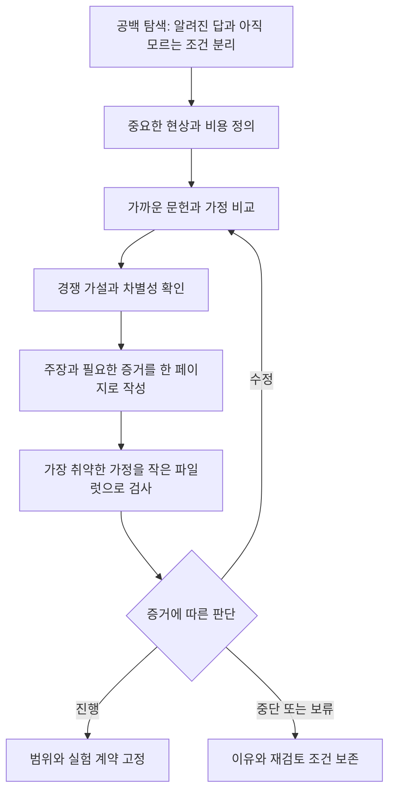

# 기존 논문에서 검증 가능한 연구 아이디어로: 본격 연구 전 빌드업 가이드

- 최초 작성: 2026-10-19 / 연구 방법론·웹 근거 갱신: **2026-11-03** / 검색 지도·후보 정리: **2026-11-17 KST**.
- 현재 새 탐색은 **VLA + RL + Computer Vision + Robotics**, 사용자의 최신 후속에 따라 **새 검색 분야와 명확한 main contribution**을 우선한다. 신뢰성·불확실성·실패/복구는 중요한 축으로 유지하되 탐색 범위를 제한하지 않는다. 후보별 적용·구현·효과 상태는 [현재 주제 index](../work/research_topics/README.md), 다음 행동은 [TODO](../TODO.md)가 관리한다. 기존 11개 중 7개를 폐기하고 3개 유지·1개 예비로 줄였다. [이전 적용 감사](../work/research_topics/README.md#nonexperimental-process-audit)는 당시 기록이다. 문서 완료를 실행 준비나 가설 입증으로 간주하지 않는다.
- 운영 기준은 [탐색 절차 감사](../work/update/BUILDUP_PROCESS_AUDIT_2026-10-28.md)의 탐색/진단/확증 구분을 따른다. 적용 이력은 [update index](../work/update/README.md)에 통합한다. 문서 완료·GPU 확보·검토 질문 준비를 각각 연구 효과·실행 가능·외부 피드백 수신으로 승격하지 않는다.
- 대상: VLA 기반 manipulation·navigation을 출발점으로, **control·RL/IL·데이터 학습·변형체·world model·3D vision·HRI 등 인접 분야**의 연구 질문까지 포함한다. 2026-10-23 사용자 요청으로 공백 탐색 범위를 넓혔으며 VLA와 RL 모두 개별 질문의 필수 조건이 아니다.
- 목적: 큰 학습·시스템 구현에 투자하기 전에 **어떤 새로운 지식을 만들 수 있는지, 가장 취약한 가정이 무엇인지, 이를 어떻게 적은 비용으로 확인할지** 판단한다.
- 성격: 연구자의 공개 경험·교육 자료와 공식 학회·저널 지침을 조사한 방법론 문서. 아래 절차·양식·robotics 예시는 이를 저장소의 연구 방향에 맞게 구성한 **연구자 해석과 실무 제안**이다.

연구 착수 전 모든 결과를 알 수는 없다. 여기서 확인하려는 것은 논문 채택 가능성의 점수가 아니라, **중요한 질문이 있고, 기존 지식과의 차이가 설명되며, 실패해도 판단을 갱신할 수 있는 실험이 있는가**다. 작은 진단 실험은 이 빌드업 단계에 포함한다.

현재 운영의 보완점은 **탐색 후보 선정, 탐색적 진단, 확증·본격 구현의 기준을 나누는 것**이다. 이전 가이드에도 불확실성을 허용하는 원칙은 있었지만, 최근 적용에서는 사전 조건부 설명·native packet 요건이 후보 선정까지 앞당겨졌다. 미확인은 반증이 아니며, 단순 baseline의 존재는 비교 필요성을 뜻한다. 그 baseline이 실제로 충분하다는 증거와 구별한다.

<a id="nonexperimental-workflow"></a>

## 비실험 buildup을 실제로 진행하는 방법 — 2026-11-03 보완

여기서 **비실험 buildup**은 문헌 조사·연구 질문 구체화·논리 검토·비교 설계를 묶은 저장소의 운영 용어다. 아래는 공개 연구 지침을 종합한 실무 제안이며, 모든 top-tier 연구자가 따르는 표준 절차나 논문 채택을 보장하는 과정은 아니다. 문헌만으로 연구의 중요성과 설계의 타당성은 검토할 수 있지만 실제 실패 빈도·성능 이득·일반화는 확정할 수 없다.

| 순서 | 지금 할 일 | 최소 산출물·다음 판단 |
|---|---|---|
| 1. 문제와 독자 | 어떤 실제 로봇 사용 상황에서 무엇이 어렵고, 답을 알면 누구의 결정이 달라지는지 쓴다 | 전문 약어 없이 문제 2–3문장. 새 방법이 없어도 중요한 질문이면 탐색 가능 |
| 2. 가까운 선행 | 넓게 발견한 뒤 가장 가까운 연구의 formulation·입출력·비교 조건·한계를 깊게 읽는다 | 해결된 것/남은 것과 직접 근거. 전체 registry 정독을 착수 요건으로 삼지 않음 |
| 3. 질문과 대안 | 주장 후보를 하나로 줄이고 이미 알려진 원리·더 단순한 설명·반례를 대조한다 | 반박 가능한 질문, 답이 없다는 주장과 아직 못 확인했다는 상태의 구분 |
| 4. 짧은 논문 이야기 | 문제–선행 차이–예상 기여–필요한 증거를 일찍 써 본다 | 결과 칸은 미확인으로 남긴 한 페이지 설명. 문서를 길게 쓰는 것이 완료 조건은 아님 |
| 5. 최소 비교 설계 | 기준선·공통 정보·관측 단위·비용·측정치·결과별 다음 결정을 정한다 | 어떤 관측이면 계속/수정/축소할지. 실행 전까지는 설계이며 결과가 아님 |
| 6. 실행 부담 | GPU뿐 아니라 adapter·원 데이터·상태 복원·평가기·사람의 구현 시간을 확인한다 | 첫 구현 산출물과 재검토 시점. 모르는 공수는 미정으로 기록하고 무기한 확장을 피함 |
| 7. 외부 비판과 반복 | 설명을 읽은 독립 연구자의 실제 반론을 받아 질문/비교를 고친다 | 질문 준비/실제 수신/반영을 구분. 미수신이면 내부 검토만 완료; 탐색 자체를 금지하지 않음 |

문제·기존 한계·새 접근·중요성·위험·비용·기간·중간 점검을 함께 묻는 근거는 [DARPA Heilmeier Catechism](https://www.darpa.mil/about/heilmeier-catechism)이다. 이를 모든 후보가 통과해야 하는 점수표로 바꾸지는 않는다. 선택적으로 깊게 읽고 가정을 재구성하는 방법은 [Keshav의 three-pass reading](https://cs.uwaterloo.ca/~brecht/courses/854-http-video-2012/readings/keshav-paper-reading.pdf)을 참고한다.

초기에 써 보며 생각을 명확히 하고 실제 독자의 비판을 받는 방법은 [Simon Peyton Jones의 강연·슬라이드](https://simon.peytonjones.org/great-research-paper/), 단순화·실패 이해·방향 재평가는 [MIT 교재 §52.2](https://visionbook.mit.edu/how_to_do_research.html)를 따른다. 이는 경험적 조언이지 해당 절차의 인과적 우월성이 검증됐다는 뜻은 아니다. [ICLR 2026 reviewer guide](https://iclr.cc/Conferences/2026/ReviewerGuide)는 명료한 문제·선행 맥락·주장을 뒷받침하는 증거·새 지식을 중시하고 SOTA를 필수로 두지 않는다. 이 **최종 논문 심사 관점**을 탐색 첫날의 증거 요구로 앞당기지 않는다.

**완료 표기:** `내부 비실험 검토 완료`는 현재 확보 가능한 문헌·논리·분석 설계가 정리됐다는 뜻이다. `외부 검토 완료`, `구현 검증 완료`, `연구 효과 확인`은 독립적으로 기록한다. 선행에 이미 있는 원리의 재조합이나 GPU 확보만으로 새 방법 기여가 확정되지 않는다.

**문서 작업 종료와 공수 점검:** 새 source·반례·피드백이 판단을 바꾸지 않는다면 같은 검색과 체크리스트를 반복하지 않는다. 실제 구현을 선택한 뒤 첫 주가 끝날 때 아래 후보 감사표의 첫 산출물과 남은 의존성을 재검토하는 것을 기본 운영 제안으로 둔다. 이는 완료 시간 예측·학습 예산·자동 실행 승인이 아니다. 작업 가능 시간과 마감이 확인되면 조정한다. 기존 P0 상한과 Docker-only 규칙은 그대로 유지한다.

<a id="stage-appropriate-gates"></a>

## 0. 지금 결정하는 단계에 맞춰 요구한다

| 단계 | 이번 결정에 필요한 최소 내용 | 아직 요구하지 않는 것 |
|---|---|---|
| 탐색 후보 선정 | 중요한 문제, 가까운 연구가 답한 범위, 아직 모르는 질문, 답에 따라 달라질 판단, 다음에 확인할 한 가지 | 완성된 원인 설명, 효과 방향, 단순 baseline의 실제 실패, 완성된 데이터·checkpoint·runtime packet |
| 탐색적 진단 | 확인할 현상/비교 질문, 강한 단순 대안, 해석 가능한 관측 단위, 제한된 범위·비용·중단 조건. 실행한다면 해당 검사에 필요한 입출력·환경 계약 | 새 방법 우월성, 모든 경쟁 설명의 제거, 출판 수준 규모·전체 ablation, 미리 확정된 방향 가설 |
| 확증·본격 구현 | 기여 유형에 맞는 주장, 공정 baseline, source/interface 확인, 고정할 metric/split/예산·해석 규칙, 실행에 필요한 manifest와 native qualification | SOTA 또는 새 architecture를 모든 기여 유형에 공통으로 요구하지 않음 |

탐색 단계의 산출물은 **잠정 질문**이어도 된다. “현상이 언제 나타나는가”, “단순 baseline이 충분한가”, “평가 조건을 바꾸면 어떤 결론이 달라지는가” 자체를 조사할 수 있다. 인과 기제를 주장할 때에는 경쟁 설명을 구별하는 추가 검사가 필요하지만, 모든 탐색 질문이 시작부터 인과 설명을 가져야 하는 것은 아니다. 탐색 중 얻은 가설은 발견 경로를 밝히고 이후 새로운 자료·봉인된 holdout 등으로 검증한다. [Nosek et al., PNAS 2018](https://doi.org/10.1073/pnas.1708274114)

**기여 유형부터 선택한다.** 방법은 개선/효율/일반화 등을, 평가·실증 연구는 중요한 결론의 타당성과 범위를, system은 실제 제약에서의 효용을, 개념 연구는 아이디어와 의미 있는 feasibility 근거를 심사한다. 새로운 알고리즘·완성된 mechanism·모든 baseline 능가를 공통 입장 조건으로 만들지 않는다. Concept/negative result라는 이름만으로 근거 기준이 낮아지는 것도 아니다. [NeurIPS 2026](https://neurips.cc/Conferences/2026/ReviewerGuidelines), [E&D 2026](https://neurips.cc/Conferences/2026/EvaluationsDatasetsReviewerGuidelines), [ECCV 2026](https://eccv.ecva.net/Conferences/2026/ReviewerContributionTypes)

**기각과 미확인을 나눈다.** 같은 질문·조건·결론이 선행에 직접 포함됨, 핵심 논리 모순, 해당 비교의 실제 부정 결과는 그 범위의 기각 근거다. 반면 mechanism 미정, natural witness 미수집, 본문/공개 자산 미확인, GPU 미확보는 각각 탐색 과제·source 불확실성·실행 대기로 기록한다. 해당 정보가 결정에 필수이면 보류할 수 있지만 가치 없음으로 치환하지 않는다. 기존 `NO-GO`는 당시 설계의 투자 판단으로 보존하며 새로운 사실 없이 자동 재개하지 않는다.

**검색과 문서 작업에도 종료점을 둔다.** 가까운 선행·강한 baseline·가장 중요한 미확인을 적고 다음 관측이 판단을 바꿀 수 있으면 그 단계의 문헌 검토를 마친다. 기본은 한 페이지 후보 카드와 판단을 바꾸는 source만이다. 더 깊게 읽을 때는 어느 질문을 해결하려는지 적는다. 모든 논문의 정독·모든 code file의 hash·전체 manifest를 초기 후보 카드의 필수 조건으로 만들지 않는다. 최종 주장 확정/구현 전 직접 충돌 확인은 유지한다.

현재 비실험 요청에서는 문헌·공개 source·기존 보고 비교·수작업 논증으로 여기까지 진행한다. 이것으로 알 수 없는 효과는 `미확인`으로 남기고, 자원이 없어 결과를 못 얻는다는 이유로 후보를 계속 새 주제로 교체하지 않는다. 이후 실행되는 toy/probe도 로컬 Docker와 scoped implementation gate를 따른다.

[GAP-TERM1](../work/update/VLA_TERMINATION_CONTRACT_REVIEW_2026-10-27.md)의 당시 설계 NO-GO·진단 HOLD는 역사로 보존한다. 순위 변화의 항등식이 새 이론이 아니라는 사실은 **평가 연구의 가치를 배제하지 않는다**. 중요한 평가 가정이 정책 선택을 얼마나·어디서 바꾸는지의 새로운 근거도 기여가 될 수 있다. GAP-PROC1은 절차만 교정했고, 후속 GAP-S3는 사용자 요청에 따라 평가 질문의 비실험 탐색을 재허용했다. 실제 중복·범위·효과의 증거 기준과 실행 전 계약은 유지한다.

[AUTH4](../work/update/VLA_CONTACT_AUTHORIZATION_BASELINE_REVIEW_2026-10-27.md)의 초기 판단 출처×갱신 빈도 분리와 identity/geometry 구별, [N4](../work/update/PROXY_SELECTION_IDENTIFIABILITY_REVIEW_2026-10-26.md)의 입력·효과·통계 단위 구별도 유지한다. 조건부 논증·source 감사·문서 완료는 정책 효과 입증이 아니다.

선행 [GAP-DE1](../work/update/DEFORMABLE_IDENTIFICATION_REVIEW_2026-10-24.md)은 task-oriented exploration이 이미 [RSS 2020](https://roboticsproceedings.org/rss16/p085.html)에 있고 [AdaptiGraph 부록](https://arxiv.org/html/2407.07889v1)에 단순 probe 비교도 있음을 반영했다. “식별할 수 있는가” 다음에는 “공통 feedback 행동으로도 해결되는데 식별하는 것은 아닌가”를 묻는다.

직전 실험 적용인 [GAP-P4 bounded pilot](../work/experiments/reactive_nav_pilot/RESULTS.md)은 동결한 384 branch 비교에서 주 가설 joint gate를 통과하지 못했다. 양의 interaction과 절대 위험 증가를 구별하고 현재 설계를 추가 sweep 없이 HOLD로 갱신했다. [GAP-CF2](../work/update/CAUSAL_DATA_SUFFICIENCY_REVIEW_2026-10-23.md) 등 기존 검토의 판정과 [분야 확장 조사](../work/update/BROAD_RESEARCH_GAP_SCOUT_2026-10-23.md)·[VLA 조사](../work/update/VLA_GAP_SCOUT_2026-10-23.md)의 근거를 보존한다. 문헌 작업 완료는 신규 연구 GO나 실험 효과 입증이 아니며, 상세 적용 목록과 교훈은 아래 표를 따른다.

이번 적용에서 추가한 판단 규칙: 서로 다른 제목의 논문을 모순으로 취급하기 전에 baseline 설정·예산 단위·결론을 대조한다. 예를 들어 [forgetting 저항성 연구, ICML 2026](https://proceedings.mlr.press/v306/liu26bu.html)와 [real-world continual VLA §5–6](https://arxiv.org/html/2605.26820v1)는 모두 적절한 replay의 효과를 지지한다. “기존 결과가 충돌한다”는 초기 동기가 본문에서 해소되면 후보 판단도 낮춰야 한다. 또한 공식 게재 논문으로 문제의 중요성을 확인하더라도 최신 preprint가 동일 개입을 이미 제안했는지 별도로 검색한다.

과거 후보를 통해 확인한 운영 교훈은 아래와 같다. 현재 판정·재개 조건은 [16개 주제별 요약](../work/research_candidates/summaries/README.md)과 [TODO](../TODO.md)가 소유한다. 이 가이드는 진행 일지를 중복 관리하지 않는다.

| 사례 | Buildup에서 재사용할 교훈 |
|---|---|
| [GAP-TERM1](../work/update/VLA_TERMINATION_CONTRACT_REVIEW_2026-10-27.md) | Goal predicate·종료 선언·종료 후 controller를 분리한다. Dummy action도 gripper를 바꿀 수 있고 release/dwell 추가는 task 강화다. Held signal은 새 관측이 아니며 subtask Stop은 global 종료가 아니다. 단순 순위 변화와 그 조건을 사전에 설명하는 기여를 구별한다. |
| [GAP-S2](../work/update/VLA_GAP_RESELECTION_2026-10-27.md) | 행동 암기·학습 데이터 누출·OOD 실패를 구별한다. Goal 도달·끝 상태 유지·자율 종료는 다른 평가 계약이다. 본문 protocol과 공개 code revision이 다르면 결과를 합치지 않는다. 저장 trajectory 절단을 종료 이후의 반사실 실험으로 해석하지 않는다. |
| [GAP-N4](../work/update/PROXY_SELECTION_IDENTIFIABILITY_REVIEW_2026-10-26.md) | 차이의 차이를 먼저 전개해 무엇이 상쇄되는지 확인한다. Selector와 최종 learner의 정보 개입, split과 selection 단위, 상관과 cutoff 이후의 선택 가치를 구분한다. Matched permutation·frame·학습 seed를 독립 scene 수로 합치지 않는다. |
| C1/C2 및 초기 로봇 간 RL 전이 | Runtime·부분 label·base competence·정책 효과는 각각 다른 검사다. 전제가 안 맞으면 큰 학습에 앞서 설계를 수정한다. |
| [C3](../work/research_candidates/2026-10-21_execution_interface/README.md) | Gripper 일부 slot의 큰 상대 변화가 전체 action에서 실질적일지는 별도 확인한다. 현상·분포상 비중·신규성·성능을 구별한다. |
| [D1 baseline 감사](../work/research_candidates/2026-10-21_d1_buildup/BASELINE_METHOD_AUDIT.md)와 [task 감사](../work/research_candidates/2026-10-21_d1_buildup/TASK_OBSERVABILITY_AUDIT.md) | 논문 수식·공개 구현·실제 value path를 대조한다. 입력 packet에 값이 존재하는 것과 action에 사용되는 것은 다르다. |
| [D1 실험 전 계약](../work/research_candidates/2026-10-21_d1_buildup/PRE_EXPERIMENT_CONTRACT.md) | 오류와 물리 변화를 분리하고 reset·controller memory까지 비교 계약에 넣는다. 문서 spec은 실행된 artifact가 아니다. |
| [E2](../work/research_candidates/2026-10-22_e2_buildup/README.md) | 같은 temporal 원리·feedback family의 재명명을 피한다. 문헌/정적 검사는 native 정책 효과·외부 피드백과 구분한다. |
| [GAP-R2](../work/update/CONTACT_INTERFACE_REVIEW_2026-10-23.md) | 구분되지 않는 숨은 상태가 있어도 공통으로 성공하는 보수적 행동이 존재할 수 있다. 센서 필요성을 주장하려면 그 행동과 충분한 history·고전 feedback을 비교한다. Public code/data의 존재·내용·실행 준비도는 별도로 확인한다. |
| [GAP-W2](../work/update/GAP_W2_COMPARATIVE_REVIEW_2026-10-23.md) | Abstract에서 안 보이던 전이 실험이 부록에 있을 수 있다. 긍정 사례·실패 사례를 찾은 뒤에는 존재 주장이 아니라 새 조건 예측을 검토한다. 이론의 보장 범위와 구현의 유한 calibration support, README와 후속 논문 버전, architecture와 optimizer/history 변경을 구분한다. |
| [GAP-L2](../work/update/LATENT_ACTION_REVIEW_2026-10-23.md) | Labels는 단계별 사용량과 unique ID 합집합을 함께 센다. Zero-shot은 어느 학습 단계에서 미노출인지 적는다. Decoder 인자 이름보다 실제 계산 경로를 확인하고, oracle latent probe·정책이 예측한 command·closed-loop 성공을 분리한다. 다른 supervision/backbone/head의 점수 차이를 representation 단독 효과로 쓰지 않는다. |
| [GAP-WM1](../work/update/WORLD_MODEL_SELECTION_REVIEW_2026-10-23.md) | 고정 후보의 평균 평가 정확도와 탐색·선택 이후의 오류를 분리한다. Critical-state proxy는 개입 이득의 oracle이 아니며 단일 recorded action은 모든 대안의 실제 결과가 아니다. 공개 code의 완성도와 선행 방법의 존재도 별개다. |
| [GAP-H1](../work/update/HRI_HELP_RELIABILITY_REVIEW_2026-10-23.md) | 도움 요청 횟수·답변 정확도·human time·native 성공을 구별한다. 실제 참가자의 simulator 평가와 scripted/LLM partner, skill API와 VLA를 혼동하지 않는다. 요청한 사례만의 label과 성공 재시도만의 집계가 어떤 선택 편향을 만드는지 확인한다. |
| [GAP-CF1](../work/update/CAUSAL_INFORMATION_COVERAGE_REVIEW_2026-10-23.md) | Hidden information·conditional action support·유한 표본 오차를 구별한다. Train-only cue와 inference sensor 추가, model token 개입과 환경 action 개입을 분리한다. 관측 빈도·작은 ensemble 분산은 causal 식별의 증거가 아니며, 같은 시간의 cue 대 추가 시연 비교도 직접 선행을 확인한다. |
| [GAP-CF2](../work/update/CAUSAL_DATA_SUFFICIENCY_REVIEW_2026-10-23.md) | 필드의 존재·시점·의미·가공 후 보존을 각각 확인한다. 사후 주석은 행동 전 정보가 아니며, command와 도달 상태 label, 원본 성공 판정과 recipe reward를 구별한다. 일부 writer에 없는 필드를 전체 release에 없다고 단정하지 않고, code의 비용 기록과 실제 공개 비교 자료도 분리한다. |
| [GAP-P1](../work/update/REACTIVE_NAVIGATION_SAFETY_REVIEW_2026-10-23.md) | 보장 event·sampling unit·적용 policy·시간 범위를 먼저 적는다. Trajectory/mission 보장이 있는 선행을 framewise로 낮춰 해석하지 않는다. 실제 사람의 기록, 궤적 replay, robot-responsive simulation을 구별하며 평균 coverage와 전환 직후 실패·liveness를 따로 본다. Public release 이름이 같아도 원 논문의 환경/metric과 동일한지 확인한다. |
| [GAP-P2](../work/update/REACTIVE_NAVIGATION_EXECUTION_REVIEW_2026-10-23.md) | 실제 entrypoint가 읽는 저장 config와 wrapper/reset까지 추적한다. 배열 순서·frame count 대신 identity와 physical target time으로 비교하고, 발행한 반경·terminal state를 보존한다. Offline interpolation·원본 truth lookahead·성공자 조건부 metric은 각각 online 정보·공정 baseline·전체 위험과 다르다. 실행 전 manifest는 미결 필드와 executable 상태를 드러내며, 작은 계약 검사와 연구 효과 pilot을 분리한다. |
| [GAP-P3](../work/experiments/reactive_nav_contract/RESULTS.md) | 작은 계약 검사는 실제 dependency와 저장 trace까지 확인한다. 동일 tick의 반복 호출·예정/실제 실행 시각을 구분하며, 통과한 테스트의 허점도 code review와 반례로 보완한다. Fixture margin·한 설정의 smoke·계약용 executable manifest를 calibrated baseline·factorial 효과·full research 준비 완료로 승격하지 않는다. |
| [GAP-P4](../work/experiments/reactive_nav_pilot/RESULTS.md) | 같은 prefix에서 분기하고 독립 calibration과 작은 held-out을 동결한다. 양의 차이의 차이는 처치군의 절대 악화를 뜻하지 않는다. 종료 후 위험과 미관측 label을 구분하고, coverage·진행·geometry와 단순 대안을 함께 본다. 사전 joint gate 실패 뒤 test 조건을 검색해 서사를 구하지 않고 HOLD로 갱신한다. |
| [GAP-DE1](../work/update/DEFORMABLE_IDENTIFICATION_REVIEW_2026-10-24.md) | Joint의 대상(state/material/friction/attachment)을 정확히 적는다. Task relevance 자체도 과거 선행을 확인한다. 부록의 단순 대안·관측 tier의 가정·probe의 물리적 효과와 정보 효과를 대조하고, solver 시간과 총 비용을 구분한다. Segmentation text·LLM planner·native VLA를 같은 interface로 세지 않는다. |
| [GAP-DE2](../work/update/DEFORMABLE_ASSET_SUFFICIENCY_REVIEW_2026-10-24.md) | Boundary라는 필드 이름보다 환경 attachment·grasp·geometric edge·workspace wall의 역할을 확인한다. Frame 수와 물리 시간, window와 독립 trial, 상위 timestamp와 최종 저장 필드를 구분한다. 사후 보간·재시도 필터·camera index 선택을 추적하되 payload 미검사 상태에서 데이터 전체의 오류율을 주장하지 않는다. |

실험 자원이 없어도 문헌·interface·경쟁 설명·비교 설계를 검토할 수 있다. 이 준비를 연구 기여의 입증으로 바꾸지 않는다. 아래 지연·navigation·3D 예시는 방법론 설명이며 활성 연구 제안이 아니다.

## 1. 조사 범위와 읽는 방법

이전 검토에서는 실행·재생 경로가 작동해도 학습 정책의 기본 능력이 확보되지 않아 주 가설을 시험하지 못했다. **문헌 검토, 설계 고정, 실행 가능성, 연구 가설의 실험 검증을 구별**해야 한다. 새 후보 역시 직접 충돌 연구와 공개 interface를 확인한 단계이며 성능·신규성 입증은 남아 있다.

연구자 본인의 글·강연, 저자들이 공개한 교재, 공식 심사·투고 지침을 우선했다. 성공한 연구자들의 경험담은 유용하지만, 특정 습관이 논문 성과를 인과적으로 높인다는 실증 연구는 아니다. 아래는 전 분야 연구자에 대한 체계적 조사나 모든 top-tier venue의 공통 규정이 아니다.

출처는 역할을 나눠 읽는다.

| 출처 유형 | 여기서 확인할 수 있는 것 | 해석의 경계 |
|---|---|---|
| 연구자의 공개 회고·조언 | 문제 선택, 읽기, 시행착오, 피드백에 대한 본인의 설명 | 모든 연구자의 실제 작업 과정으로 일반화하지 않는다 |
| 연구 교육 자료 | 가정을 점검하고 생각을 정리하는 재사용 가능한 도구 | 제시된 방법이 유일한 순서는 아니다 |
| 공식 학회·저널 지침 | 해당 venue·연도가 기대하는 기여와 증거의 종류 | 아이디어 단계의 채택 보장이나 자동 평가식이 아니다 |
| 완성된 논문 | 최종 주장·방법·실험과 선행 연구의 관계 | 저자가 처음 아이디어를 얻은 순서를 복원할 수는 없다 |

이 구분은 중요하다. Steinhardt는 완성된 논문만 읽으면 연구자의 사고 과정과 중간 판단이 잘 보이지 않는다고 설명한다. 따라서 논문의 논리 구조와 저자의 실제 발견 과정을 구분한다. [Jacob Steinhardt, *Film Study for Research*](https://jsteinhardt.stat.berkeley.edu/blog/film-study)

처음에는 2–4절로 판단 기준을 잡고, 실제 후보가 생기면 5–8절의 절차와 예시를 적용한다. 10절에는 복사해서 쓸 수 있는 검토 양식이 있다.

## 2. 연구자들은 무엇을 반복해서 하는가

### 2.1 Andrej Karpathy: 해결할 문제 자체를 고르는 능력을 훈련한다

Karpathy는 문제를 푸는 작업과 **어떤 문제가 중요하고 지금 풀 수 있는지 고르는 작업**을 구분한다. 자신의 박사과정 회고에서는 이미지와 언어의 연결에 관심을 갖게 된 이유로 남아 있는 질문의 폭, 설명 가능한 중요성, 당시 기술·데이터의 준비 상태 등을 든다. 이는 그가 직접 설명한 사례이지, 사후에 논문 제목에서 추정한 동기가 아니다. [*A Survival Guide to a PhD*, “Research topics”](https://karpathy.github.io/2016/09/07/phd/)

**여기서 적용할 습관:** 후보마다 “왜 중요한가?”와 “왜 지금 접근 가능한가?”를 따로 적는다. VLA 모델이 공개되었다는 사실은 실행 가능성의 근거가 될 수 있지만, 연구 질문의 중요성까지 설명하지는 않는다.

### 2.2 S. Keshav: 읽기 깊이를 나누고, 핵심 논문은 스스로 재구성한다

Keshav의 three-pass 방법은 전체 구조 파악, 내용 이해, 깊은 재구성으로 읽기를 나눈다. 마지막 단계에서는 저자의 가정 아래에서 논리를 스스로 다시 만들어 보며 숨은 가정과 약점을 찾는다. 여기서 말하는 virtual re-implementation은 반드시 코드를 모두 실행한다는 뜻은 아니다. [*How to Read a Paper*, §2–3, ACM SIGCOMM CCR, 2007; Waterloo 공개본](https://cs.uwaterloo.ca/~brecht/courses/854-http-video-2012/readings/keshav-paper-reading.pdf)

**여기서 적용할 습관:** 넓게 찾을 때는 후보를 선별하고, 아이디어와 직접 충돌하는 논문은 objective·input·action·evaluation을 재구성할 정도로 읽는다. 모든 registry 논문을 읽은 뒤에야 아이디어를 시작할 필요는 없다.

### 2.3 Torralba·Isola·Freeman: 작은 문제에서 가정과 실패 원인을 분리한다

세 저자의 교재는 연구가 잘되지 않는 이유가 구현 오류인지, 가정의 오류인지부터 구분해야 한다고 설명한다. 핵심을 보존한 toy model과 해석 가능한 실험을 강조한다. 색 항상성 문제를 관측값 `y = a × b`에서 두 요인을 추정하는 문제로 줄인 예는, 복잡한 파이프라인을 구현하기 전에 모호성을 드러내는 사고 실험이다. [*Foundations of Computer Vision*, §52.2](https://visionbook.mit.edu/how_to_do_research.html)

**여기서 적용할 습관:** “전체 VLA 시스템이 실패했다”를 “어느 관측 조건에서 어느 제어 결정이 실패했는가”로 줄인다. 단일 요인 실험으로 시작하되, 요인 간 상호작용이 핵심인 질문이라면 이후 factorial comparison도 설계한다.

### 2.4 Simon Peyton Jones: 쓰기를 통해 아이디어의 빈칸을 발견한다

Peyton Jones는 아이디어가 완성된 뒤 쓰기 시작하는 대신, 일찍 글을 써서 주장과 모르는 부분을 명확히 하고 비판을 받으라고 권한다. 기여는 독자가 이해할 수 있는 중심 아이디어로 정리하고, 각 주장에 필요한 증거를 연결한다. [저자 강연 페이지](https://simon.peytonjones.org/great-research-paper/), [공개 슬라이드, “Writing papers: model 2”·“The idea”·“Evidence”](https://www.microsoft.com/en-us/research/uploads/prod/2016/07/How-to-write-a-great-research-paper.pdf)

**여기서 적용할 습관:** 초기에는 한 페이지로 문제·가설·차이·필요한 실험을 쓴다. 결과가 없는 부분은 예상 또는 미확인으로 표시한다. 글을 자연스럽게 만들기 위해 결과가 이미 나온 것처럼 작성하지 않는다.

### 2.5 Jacob Steinhardt: 다른 연구자의 판단과 자신의 판단을 비교한다

Steinhardt가 제안하는 film study와 act–reflect–ask는 좋은 결과만 수집하기보다, 어떤 판단을 했고 무엇을 놓쳤는지 복기하는 습관이다. 연구자의 공개 글, 토론, 멘토의 사고 과정을 통해 판단 전략을 배울 수 있다고 설명한다. [*Film Study for Research*, “Film Study”·“Act-Reflect-Ask”](https://jsteinhardt.stat.berkeley.edu/blog/film-study)

**여기서 적용할 습관:** 논문의 방법·결과를 보기 전에 “내가 저자라면 무엇을 먼저 확인할까?”를 적고, 실제 선택과 비교한다. 이는 이 문서에서 제안하는 연습이다. 저자의 내적 동기를 사실처럼 쓰지 말고, 왜 특정 실험이 필요했는지에 대한 자신의 설명을 기록한다.

### 2.6 실제 회고에서 얻을 수 있는 빌드업의 모양

Karpathy의 사례에서 배울 부분은 특정 분야 조합 자체보다 **질문의 중요성, 후속 질문의 여지, 실행을 가능하게 한 조건을 함께 판단했다는 점**이다. Freeman 등이 소개한 toy model에서는 **관측과 숨은 요인 사이의 모호성을 작은 문제로 드러내는 방식**을 볼 수 있다. 이 두 사례를 종합하면 문제를 고르는 판단과 문제를 검증 가능한 크기로 줄이는 판단이 함께 필요하다. 이는 위 회고·교재를 현재 연구에 적용한 해석이며, 두 연구가 동일한 절차를 따랐다는 뜻은 아니다.

## 3. Top-tier 기준을 아이디어 단계의 질문으로 바꾸기

학회 이름을 목표로 정하는 것만으로 연구 가치를 판별할 수 없다. 아래는 공식 지침에서 확인한 기준과, 그 기준을 초기 검토에 적용한 질문이다.

| 공식 출처 | 확인한 기준 | 초기 검토에 적용할 질문 |
|---|---|---|
| [ICLR 2026 Reviewer Guide](https://iclr.cc/Conferences/2026/ReviewerGuide) | 구체적 문제, 문헌 속 동기, 주장에 대한 엄밀한 증거, 공동체에 주는 새로운 지식과 가치. SOTA가 필수는 아님 | 성공하면 기존에 몰랐던 무엇을 알게 되는가? 이를 보여 줄 비교가 있는가? |
| [NeurIPS 2026 Evaluations & Datasets 지침](https://neurips.cc/Conferences/2026/EvaluationsDatasetsReviewerGuidelines) | 기여 유형에 맞는 quality·clarity·significance·originality. 기존 평가의 한계와 negative result도 체계적으로 검증하면 가치가 있음 | 새 알고리즘이 없어도 평가 관행이나 기존 결론을 바꾸는가? 부정 결과를 설명할 통제가 있는가? |
| [RSS 2026 Call for Papers](https://roboticsconference.org/2026/information/cfp/) | 새로운 scientific contribution과 systems contribution을 모두 모집 | 시스템 통합을 통해 어떤 새로운 robot capability 또는 재사용 가능한 설계 지식을 입증하는가? |
| [IEEE T-RO Information for Authors](https://www.ieee-ras.org/publications/t-ro/t-ro-information-for-authors/) | 독창적이고 중요한 결과. 기존 연구의 증명·실험·설명을 단순히 늘리는 것 이상의 기여 요구 | 추가 구현·실험의 양을 제외해도 새로운 주장과 실질적인 발전이 남는가? |
| [ECCV 2026 Contribution Types](https://eccv.ecva.net/Conferences/2026/ReviewerContributionTypes) | 기여 유형에 맞춰 평가하며 동일한 요구를 모든 논문에 강제하지 않음 | 새 알고리즘, 원인 설명, 시스템 능력, 평가 자산 중 무엇을 주장하는가? 그 유형에 맞는 결정적 증거는 무엇인가? |
| [NeurIPS Paper Checklist](https://neurips.cc/public/guides/PaperChecklist) | 주장·한계, 실험의 변동, 재현에 필요한 설정·계산 정보 명시 | 관측 단위·seed·trial·예산을 구분하고, 결과보다 넓은 주장을 피할 수 있는가? |

NeurIPS 항목은 **E&D track**의 지침이다. 이를 모든 트랙의 동일한 평가 규정으로 일반화하지 않는다. RSS는 연도별 페이지를 사용했다. 공식 웹사이트의 최신 연도 페이지와 과거 검색 색인이 다를 수 있으므로 실제 페이지의 연도를 확인한다.

이 기준을 종합해 후보를 다음 다섯 축으로 검토한다. 점수를 합산하는 채택 예측식은 사용하지 않는다.

1. **중요성:** 이 문제가 해결되면 누구의 어떤 판단·능력·비용이 달라지는가?
2. **차별성:** 가장 가까운 선행 연구와 비교해 질문, 조건, 방법, 설명 중 무엇이 달라지는가?
3. **검증 가능성:** 가설이 틀렸을 때 나타날 결과가 정의되어 있는가?
4. **실행 가능성:** 데이터·환경·관측·기반 코드·예산으로 결정적인 비교를 할 수 있는가?
5. **재사용 가능성:** 특정 checkpoint·장면을 넘어 다른 연구자가 활용할 지식이나 도구가 남는가?

예컨대 새 모듈의 성능 향상이 있어도 중요성과 차별성이 약할 수 있다. 반대로 단순한 방법이라도 기존 설명을 교정하거나 비용 제약 아래 가능한 행동을 바꾸면 검토할 가치가 있다. 기여의 크기는 후속 증거로 판단한다.

**2026-10-23 보완:** 초기 진단 연구를 억지로 새 architecture로 포장하지 않는다. 그렇다고 실패 사례 수집만으로 기여가 성립하지도 않는다. 기존 설명과 다른 예측, 공정한 대조, 다른 조건에 재사용할 판단이 필요하다. ECCV의 기여 유형은 평가 관점이지 합격용 체크리스트가 아니며, ICLR은 SOTA 자체를 필수로 요구하지 않는다. 최근 preprint를 확인하는 것은 우리 투자 판단을 위한 검색 범위다. 이를 venue가 모든 동시기 preprint와의 비교를 의무화했다는 뜻으로 쓰지 않는다. [ECCV 지침](https://eccv.ecva.net/Conferences/2026/ReviewerContributionTypes), [ICLR 지침의 Evaluation·contemporaneous work](https://iclr.cc/Conferences/2026/ReviewerGuide).

문헌 검토의 통과는 **다음 탐색 또는 작은 파일럿에 투자할 근거**다. 신규성·가설·정책 효과의 입증과 구분한다. 실험을 시작할 때는 질문, 직접 충돌 범위, 그 검사에 실행 가능한 비교와 해석·중단 기준을 확보한다. 탐색에서는 효과의 방향과 원인 가설이 미정이어도 되며, 확증 단계에서 주장과 분석을 고정한다.

## 4. 주제, 질문, 가설, 기여를 분리하기

| 구분 | 예시 — 아직 검증되지 않은 설명용 후보 | 다음에 필요한 것 |
|---|---|---|
| 주제 | VLA + RL로 manipulation을 개선한다 | 실패 조건과 관심 결과를 좁힌다 |
| 문제 현상 | 관측 이후 물체 상태가 바뀔 때, 실행 중인 action chunk의 성공률이 낮아지는가? | 현상이 실제로 있는지 확인한다 |
| 연구 질문 | 같은 추론 예산에서 언제 다시 관측하고 action을 갱신해야 하는가? | 선행 연구가 이미 답한 범위를 조사한다 |
| 가설 | 평균 chunk 길이보다 상태 변화 시점과 갱신 시점의 정렬이 일부 실패를 더 잘 설명한다 | 경쟁 설명과 구별할 intervention을 설계한다 |
| 방법 후보 | 제한된 action 갱신 예산을 상태 변화 신호에 따라 배분한다 | 단순한 주기 조정·threshold 정책과 비교한다 |
| 기여 후보 | 특정 변화 조건에서 갱신 시점의 효과와 비용을 분리하는 평가·설계 지식 | 실제 결과와 선행 연구 대비 차이가 필요하다 |

이 예시는 신규성을 주장하지 않는다. 특히 action chunk 길이와 반응성은 이미 연구된 문제다. 핵심은 알고리즘 이름을 먼저 고정하지 않고, **문제의 존재 → 설명 → 필요한 개입**으로 구체화하는 것이다.

<a id="5-문헌에서-아이디어로-넘어가는-8단계"></a>

## 5. 공백 탐색 후 문헌에서 아이디어로 넘어가는 8단계

이 단계는 조언을 종합한 실무 절차다. 2026-10-23부터 **단계 0의 공백 탐색을 먼저 수행**한다. 기존 후보의 1–8 단계 ID는 유지한다. 앞 단계의 가정이 깨지면 돌아가며, 실험 결과와 문헌 조사는 서로를 계속 수정한다. [VLA 적용](../work/update/VLA_GAP_SCOUT_2026-10-23.md) · [다분야 적용](../work/update/BROAD_RESEARCH_GAP_SCOUT_2026-10-23.md).



### 단계 0. 방법 이름을 붙이기 전에 공백을 조사한다

1. **범위를 고정한다.** 관심 시스템·행동·실패 비용, 검색 종료일, 최근 3개 calendar year, 우선 venue를 기록한다. 분야 전체의 미해결 문제를 증명하려 하지 말고 어떤 사용 조건의 판단을 바꿀지 정한다. VLA·RL·3D·새 센서의 사용 여부는 질문 뒤에 결정한다.
2. **Registry와 외부 문헌을 함께 찾는다.** 정확한 제목뿐 아니라 현상·가정·경쟁 설명·동의어로 검색한다. 공식 proceedings/program → 저자 본문·code를 추적한다. 최근 preprint도 직접 충돌 확인에 포함하되 채택 논문과 구별한다. 발견 출처와 주장 근거를 분리한다.
3. **알려진 답을 먼저 기록한다.** 논문별로 `질문 → 실제 평가 조건 → 확인된 범위 → 미확인 범위`를 적는다. 새 benchmark의 존재, 저자가 적은 limitation, registry에서의 누락은 각각 연구 공백의 증명이 아니다.
4. **표면적 충돌을 해소한다.** 상반된 결과를 발견하면 observation/history, sensor coverage, action/controller, 데이터 support, train/test split, 예산, metric을 맞출 수 있는지 확인한다. 비교 조건이 다르면 우선 설명 가능한 조건 차이이며 논문 간 모순이라고 쓰지 않는다.
5. **남은 질문의 가치를 검사한다.** 답에 따라 데이터 수집·센서 구매·controller 선택·평가 결론 중 무엇이 바뀌는지 적는다. 기존 방법을 다른 benchmark에서 실행하는 것만 남으면 독립 기여로 채택하지 않는다.
6. **가장 강한 반례를 찾는다.** 새 후보가 과거 HOLD/NO-GO의 재명명인지 대조하고, 이미 같은 조건·대조·결론을 갖춘 논문을 우선 찾는다. 새 반례가 나오면 순위와 주장을 즉시 낮춘다. 검색 결과가 없다는 사실만으로 신규성을 확정하지 않는다.

**산출물:** 날짜·검색 범위·source/version·확인 깊이·포함/제외 이유를 갖춘 조사 기록, track의 `Open Questions`에 있는 조건부 질문, 그리고 그 질문을 없앨 직접 선행 연구 또는 결과. 논문을 모두 정독했다거나 체계적 문헌고찰을 완료했다고 표시하지 않는다. 검색은 핵심 판단을 바꿀 미확인 문헌을 특정한 시점에 일단 닫고 후속 항목으로 넘길 수 있다.

**분야 공백과 신규 기여를 나누는 규칙:** 선행 연구가 있다는 사실로 분야 전체를 NO-GO로 처리하지 않는다. `중요한 열린 문제 → 기존 방법이 답한 조건 → 아직 확인되지 않은 조건 → 우리 비교가 줄 추가 지식`을 각각 적는다. 저자의 future work도 후속 논문이 이미 해결했을 수 있으며, abstract에서 안 보이는 실험을 “없다”고 쓰지 않는다. 여러 분야를 비교할 때는 과학적 가치와 현재 자원의 적합성을 분리한다. Hardware가 없다는 이유로 문제의 가치를 낮추거나, GPU로 돌리기 쉽다는 이유로 신규성을 높이지 않는다. 이 규칙은 이번 조사에서 정리한 운영 원칙이다.

문장마다 **논문이 보고한 사실 / 연구자 추론 / 아직 확인하지 않은 주장**을 나눈다. 이 구분은 조사용 표현이며 reading tracker의 status/evidence enum을 추가하는 것이 아니다. 단계 0은 MIT 교재의 가정 검사와 ICLR의 구체적 질문·새 지식 기준을 이 저장소에 적용한 절차이며, 해당 기관이 정한 공통 연구 순서가 아니다. [MIT 교재](https://visionbook.mit.edu/how_to_do_research.html), [ICLR 2026 지침](https://iclr.cc/Conferences/2026/ReviewerGuide).

### 단계 1. 해결되면 달라질 일을 먼저 적는다

한 문장에 **사용자/로봇, 조건, 실패 또는 비용, 개선의 의미**를 넣는다. “generalization이 부족하다”보다 “관측 시야 밖에서 물체 위치가 바뀐 뒤 다시 접근할 때, 오래된 위치 기억 때문에 잘못된 접근 행동을 선택하는가?”가 검사하기 쉽다.

DARPA의 Heilmeier 질문은 목표, 현재 접근과 한계, 새 접근의 이유, 성공의 의미, 위험, 비용, 기간, 중간·최종 검증을 묻는다. 여기서는 연구 프로그램 제안 도구를 작은 연구 후보의 점검에 적용한다. 학회 심사표는 아니다. [DARPA, *The Heilmeier Catechism*](https://www.darpa.mil/about/heilmeier-catechism)

**산출물:** 문제 한 문장 + 중요성을 뒷받침할 source/관측 + 아직 확인하지 못한 부분. 논문이 보고한 제한과 내가 예상하는 실패를 별도 표시한다.

### 단계 2. 질문을 판단하는 데 필요한 문헌 집합을 만든다

다음 역할을 채우는 논문을 찾는다. 편수 quota는 두지 않는다.

- 문제·objective·표현을 만든 foundation.
- 같은 조건과 주장을 다루는 가장 가까운 방법.
- 제안 방법 없이도 답할 수 있는 강한 단순 baseline.
- 주장의 성립 조건을 시험할 benchmark·dataset·evaluation protocol.
- 내 해석과 반대되는 결과, 다른 원인 설명, 실패 또는 재현 연구.

처음에는 abstract·그림·관련 연구로 범위를 좁히고, 직접 경쟁하는 논문은 본문·부록·공개 code의 interface를 확인한다. 최신성 검색은 최근 3개 calendar year를 우선하되, 핵심 메커니즘은 과거와 인접 분야까지 추적한다.

**잠정적으로 탐색을 멈출 조건:** 가까운 방법들의 계보와 차이가 설명되고, 새 검색 결과가 이미 알고 있는 family로 수렴하며, 미확인 문헌을 명시할 수 있을 때다. 검색이 포화되었다는 판단도 잠정적이다. 큰 학습 직전과 논문 주장 확정 전에 다시 확인한다.

### 단계 3. 요약 대신 가정·interface·증거를 비교한다

각 행은 논문 하나이며, 확인되지 않은 칸은 비워 두거나 `확인 필요`로 기록한다.

| 논문·source anchor | 문제/적용 조건 | policy-visible input·state | action·결정 시점 | 학습 신호·데이터 | 성립에 필요한 가정 | 실제 평가·baseline | 아직 답하지 않은 질문 |
|---|---|---|---|---|---|---|---|
| 제목, §/표/그림/code 위치 | 조건을 구체화 | GT와 추정값 구분 | 실행 길이·feedback·memory | supervision·reward·예산 | 관측 가능성·정확도·정적 환경 등 | split·metric·실패 범위 | 저자 한계 / 내 추론 구분 |

표를 채운 뒤 “A보다 B가 좋다”보다 **A와 B가 실제로 같은 문제를 풀고 있는가?**를 먼저 확인한다. 정보량·demonstration·interaction·추론 예산·robot embodiment가 다르면 성능 숫자를 바로 비교하지 않는다.

### 단계 4. 비어 있는 칸을 연구 질문으로 바꾼다

문헌에 없다는 이유만으로 가치가 생기지는 않는다. 다음 유형을 출발점으로 삼고, 그 빈칸이 robot behavior를 어떻게 제한하는지 설명한다.

| 문헌에서 발견한 패턴 | 만들 수 있는 질문 | 먼저 배제할 쉬운 설명 |
|---|---|---|
| 여러 방법이 같은 강한 가정을 둠 | 그 가정이 깨질 때 성능·안전의 경계는 어디인가? | 환경 설정이나 구현 오류 |
| 비슷한 주장에 결과가 상충함 | 데이터·정보·예산 차이가 결론을 바꾸는가? | baseline tuning과 split 불일치 |
| representation 점수는 좋아지지만 행동은 그대로임 | 어떤 오차가 실제 action choice를 바꾸는가? | downstream policy가 새 표현을 사용하지 못함 |
| planner와 controller 사이에서 실패가 집중됨 | 결정 시간척도나 상태 전달이 병목인가? | 센서 지연·timestamp·coordinate 오류 |
| 평균 성능이 특정 실패를 가림 | 기존 metric이 무엇을 놓치며 결론이 바뀌는가? | 드물고 중요하지 않은 사례만 선별함 |
| 새로운 센서·데이터·기반 모델을 사용할 수 있음 | 이전에는 검증 불가능했던 어떤 질문이 이제 가능한가? | 기존 방법에 자원만 추가한 효과 |

확증할 설명이 생기면 **가설 H1과 경쟁 설명 H0/H2**를 함께 작성한다. 아직 현상 탐색 중이면 방향 없는 질문과 가능한 설명 목록으로 시작해도 된다. 예: 실패 원인이 feedback 시점인지, observation 품질인지, 학습 데이터 coverage인지 조사한다. 한 가설이 지지되지 않았다는 사실만으로 다른 가설이 참이라고 결론 내리지 않는다.

### 단계 5. 가장 가까운 선행 연구와 정면으로 비교한다

검색어에는 모델 이름뿐 아니라 메커니즘의 동의어를 넣는다. 예를 들어 action 갱신 문제라면 `action chunking`, `receding horizon`, `reactive policy`, `event-triggered control`, `adaptive horizon`, `temporal abstraction`까지 확인한다. VLA 논문 안에서만 검색하면 control·RL의 기존 개념을 놓칠 수 있다.

후보마다 다음을 기록한다.

1. 가장 가까운 논문과 최신 후속 연구의 정확한 식별자·version·공식 source.
2. 그 연구가 이미 해결한 질문과 적용 조건.
3. 내 후보와 **같은 부분**, 실제로 다른 부분, 아직 대조하지 못한 부분.
4. 그 논문에 충분한 tuning이나 간단한 수정만 해도 내 결과가 나올 가능성.
5. 차이가 있어도 그 차이가 중요한 이유.

Top-tier 논문을 중심으로 읽되 novelty 검색에는 최신 preprint도 포함한다. Preprint와 accepted status는 구별한다. “찾지 못했다”는 결과를 “아무도 하지 않았다”로 바꾸지 않는다.

**산출물:** closest-work 비교표와 잠정 novelty 문장. 직접 충돌하는 논문의 본문·공개 interface 확인이 끝나지 않았으면 대규모 구현 착수 조건을 충족한 것으로 보지 않는다.

### 단계 6. 방법보다 먼저 주장–증거 연결을 쓴다

한 페이지 초안에 다음 질문을 연결한다.

- 기존에는 무엇을 알고 있었는가?
- 어떤 조건에서 그 지식만으로는 판단하기 어려운가?
- 새로 검증할 주장은 무엇인가?
- 어떤 결과가 나오면 그 주장을 줄이거나 버려야 하는가?
- 독자가 재사용할 것은 알고리즘, 설명, 경계 조건, 평가 도구 중 무엇인가?

| 잠정 주장 | 필요한 증거 | 반대 설명 | 구별할 비교 | 현재 상태 |
|---|---|---|---|---|
| 한 문장에 한 주장 | 관측·분석·실험·증명 중 적합한 것 | 가장 설득력 있는 대안 | 결과에 따라 판단이 달라지는 비교 | 미실행 / 예비 결과 / 검증 완료의 실제 범위 |

예상 결과표를 만들 때 숫자는 채우지 않는다. 열·조건·metric과, 방향 가설이 있는 경우에만 그 방향을 적는다. 이 표의 목적은 긍정적인 결과를 약속하는 것이 아니라, **어떤 결과를 얻어도 판단을 갱신할 준비를 하는 것**이다. 탐색으로 얻은 예측을 사전에 정한 것처럼 쓰지 않는다.

### 단계 7. 가장 취약한 연결부터 저비용으로 검사한다

다음 중 현재 불확실성을 가장 많이 줄이는 검사를 선택한다. 모든 후보가 순서대로 전부 수행할 필요는 없다.

| 검사 | 확인할 것 | 결과의 한계 |
|---|---|---|
| 논리적 counterexample·toy problem | 문제 formulation의 모순, 필요한 정보, 비식별성 | toy에서의 성립이 real-robot 성립을 보장하지 않음 |
| 기존 결과·로그 재분석 | 현상 빈도, failure stratum, metric의 누락 | 기록된 정책 밖의 counterfactual action 결과는 알 수 없음 |
| 단순 baseline | tuning, 주기 변경, 규칙만으로 충분한지 | 부실하게 조정한 baseline의 실패는 새 방법의 근거가 아님 |
| privileged diagnostic comparator | 정확한 상태·이벤트를 알 때 개선 여지가 있는지 | 추가 정보를 쓰면 배포 가능한 공정 baseline이나 수학적 상한이 아님 |
| 작은 closed-loop 실험 | 실제 관측–행동 변화가 결과를 바꾸는지 | 소수 장면·seed 결과로 일반화를 주장할 수 없음 |
| input availability·latency 검사 | 필요한 신호를 필요한 시점에 얻을 수 있는지 | 오프라인의 좋은 추정 성능만으로 실시간 가능성을 판단하지 않음 |

시간·compute를 더 쓰기 전에 **어느 결과가 나오면 다음 결정을 바꿀지** 적는다. 다양한 모델을 무작정 돌려서 좋은 숫자를 찾는 것은 이 단계의 대체물이 아니다.

### 단계 8. 외부 비판을 받고 진행·수정·중단을 결정한다

지도교수나 동료에게 긴 아이디어 목록보다 문제 한 문장, closest-work 비교, 가장 중요한 예비 증거, 다음 실험을 보여 준다. “괜찮아 보이나요?” 대신 다음 질문으로 피드백을 요청한다.

- 이 주장을 이미 설명한 가장 가까운 논문은 무엇인가?
- 문제의 중요성에 동의하지 않는다면 어떤 근거가 부족한가?
- 제안한 실험이 배제하지 못하는 대안 설명은 무엇인가?
- 추가 정보·데이터·추론 예산을 은근히 더 쓰고 있지는 않은가?
- 가장 저렴하게 이 가설을 틀렸다고 보여 줄 실험은 무엇인가?
- 결과가 모두 예상대로 나와도 독자에게 남는 새 지식이 약한가?

피드백은 문헌 확인, 가설 수정, 실험 변경 중 구체적인 행동으로 기록한다. 전문가의 기대는 유용한 prior이며 최종 증거를 대신하지 않는다.

## 6. VLA + RL manipulation 예시: 아이디어를 좁혀 가는 과정

**아래는 절차 설명용 가상 사례다. 실제 pilot 결과도, 신규성이 확인된 프로젝트도 아니다.** 환경·checkpoint·trial 수·budget은 아직 정하지 않았으므로 실행 명세로 사용할 수 없다.

### 6.1 출발점과 충돌하는 기존 연구

출발 문장: “VLA에 RL과 adaptive action chunk를 붙여서 더 reactive하게 만들자.”

이 문장만으로는 무엇이 새롭고 무엇을 검증할지 알 수 없다. 저장소에도 [Q-chunking](../2025/NeurIPS/2025_NeurIPS_Reinforcement-Learning-with-Action-Chunking/01_overview.md), [Decoupled Q-Chunking](../2026/ICLR/2026_ICLR_Decoupled-Q-Chunking/01_overview.md), [OpenVLA-OFT](../2025/RSS/2025_RSS_Fine-Tuning-Vision-Language-Action-Models-Optimizing-Speed/01_overview.md)가 있으므로 우선 비교해야 한다.

특히 DQC의 공개 자료는 critic과 actor의 chunk 길이를 분리하는 접근을 설명한다. 따라서 “긴 value horizon과 짧은 action horizon을 분리한다”는 발상만을 새 기여로 삼을 수는 없다. [DQC 저자 공개 repository](https://github.com/ColinQiyangLi/dqc). 이 문서에서 DQC의 모든 실험·코드를 정독하거나 실행한 것은 아니며, 저장소 note도 `ABSTRACT_CHECKED`다. contact 조건이나 event-triggered 실행과의 정확한 차이는 **본문·interface 확인 필요**다.

### 6.2 질문을 좁힌다

잠정 질문: **외부 변화가 있는 manipulation에서, 같은 추론 자원 제약 아래 action 갱신 시점이 recovery에 주는 효과를 평균 실행 길이·관측 품질의 효과와 구분할 수 있는가?**

| 경쟁 가설 | 구별에 도움이 될 관측·개입 |
|---|---|
| H1: 중요한 변화 직후에 갱신하지 못하는 것이 병목 | 동일한 평균 호출 예산에서 변화 시점에 맞춘 갱신과 주기적 갱신의 차이 |
| H2: 관측이나 상태 추정 자체가 부정확한 것이 병목 | 갱신 시점이 같을 때 관측 품질을 바꾸는 진단 비교 |
| H3: 정책이 해당 상태에서 복구 행동을 학습하지 못함 | 정확한 정보와 빠른 갱신을 제공해도 개선되지 않는 조건의 분석 |

H3의 증거를 얻으려면 행동 능력과 데이터 coverage도 별도로 확인해야 한다. H1이 지지되지 않았다는 결과만으로 H3를 확정하지 않는다.

### 6.3 새 RL 학습 전에 할 검사

1. 기존 policy의 입력·출력·timestamp·action 실행을 확인한다. 성공하는 nominal condition을 확보한 뒤 외부 변화 조건에서 실패가 반복되는지 본다.
2. 고정된 checkpoint로 실행 길이·관측 지연·외부 변화 시점을 조절한다. 이는 해당 policy의 작동 원인을 진단하는 실험이며, 각 method family의 최적 성능 비교와 구별한다.
3. 같은 action 후보와 실제 가용 신호를 사용하는 주기적 갱신·간단한 threshold 규칙을 비교한다. 신호 계산 비용도 포함한다.
4. 정확한 이벤트 시점을 주는 privileged comparator로 개선 여지를 진단한다. 이를 배포 가능한 경쟁 baseline과 섞어 순위를 매기지 않는다.
5. 개선 여지가 있으면 그 이벤트를 실제 관측으로 제때 탐지할 수 있는지 확인한다. 그 뒤에야 학습할 결정이 남아 있는지 판단한다.

기존 로그의 action을 다른 것으로 바꿔 끼운 재생만으로는 새로운 closed-loop 결과를 알 수 없다. 행동이 다음 관측을 바꾸는 비교는 simulator 또는 실제 상호작용이 필요하다. 이 단계에서 로봇·센서·RL·world model을 동시에 새로 도입하면 원인 구분이 어려워진다.

### 6.4 공정성과 측정 계약

- **자원:** 호출 수만 맞추지 말고 model compute, sensor 처리, controller overhead, wall-clock latency를 함께 기록한다. 하나의 예산으로 정렬되지 않으면 성능–비용 곡선을 비교한다.
- **정보:** policy-visible input과 privileged information을 명시한다. 미래 상태·정답 이벤트를 쓰는 진단 비교는 별도 표시한다.
- **학습:** 새 RL을 도입할 때는 demonstration, environment interaction, reward, reset·human intervention 예산을 정렬하거나 차이를 보고한다.
- **결과:** 전체 성공률, 사전에 정의한 변화 조건별 성공·복구 시간, task에 맞는 contact/collision 지표를 기록한다. 좋은 장면만 골라 평균내지 않는다.
- **변동:** paired scenario를 사용할 수 있으면 조건을 맞추고, seed·episode·task를 구분한다. 영상 frame을 독립 trial처럼 세지 않는다. pilot에서 변동을 추정한 뒤 본 실험 규모를 정한다.
- **외삽:** 하나의 checkpoint에서 얻은 결과의 범위와, 다른 policy·task·hardware에서 확인해야 할 범위를 나눈다.

### 6.5 결과별 판단을 미리 적는다

| 파일럿 결과 — 모두 가정적 상황 | 합리적인 다음 행동 |
|---|---|
| nominal 동작부터 재현되지 않음 | 환경·interface·baseline을 수정한다. 연구 가설의 반증으로 해석하지 않는다 |
| 작은 주기 조정만으로 현상이 대부분 해소됨 | 복잡한 learned scheduler의 필요성을 재검토한다. 단순 baseline의 강점을 보고한다 |
| privileged comparator에도 개선 여지가 거의 없음 | 현재 action set과 조건에서 timing 가설의 우선순위를 낮춘다. 다른 병목은 별도 검사한다 |
| privileged comparator만 좋고 가용 관측으로 이벤트를 구분할 수 없음 | 정보 가정부터 수정하거나 문제 범위를 줄인다 |
| 실제 신호를 쓰는 단순 규칙도 예산 내에서 효과가 있음 | 설명·일반화·기존 연구 대비 차이를 확인한다. RL이 필요한지는 별도 질문이다 |
| 적절한 baseline과 문헌 비교 후에도 새 조건·설명이 남음 | 가장 작은 학습 후보를 구현하고 holdout 조건에서 검사할 명세를 작성한다 |

긍정적인 pilot도 논문 기여의 확정은 아니다. 반대로 단순 규칙이 잘된 결과가 자동으로 실패한 프로젝트도 아니다. 어떤 기존 믿음이나 설계 선택을 바꾸는지, 그 지식이 이미 알려져 있는지에 따라 후속 방향을 정한다.

## 7. Navigation·3D로 옮겨 적용하기

아래도 **미검증 질문의 예시**다. 해당 분야의 미해결 문제라는 판정을 내린 것이 아니다.

| 방향 | 막연한 출발 | 더 좁은 질문 | 먼저 할 진단 | 주의할 대안 설명 |
|---|---|---|---|---|
| Navigation memory | VLA에 spatial memory를 추가한다 | 재방문 시 이전 기억의 내용 오류와 localization 오차가 잘못된 경로 선택에 각각 얼마나 기여하는가? | 작은 환경에서 기억 상태와 localization 품질을 독립적으로 조절하고 정책 선택을 비교 | 기억 길이보다 pose·timestamp 오류가 원인일 수 있음 |
| Navigation + RL | 장기 navigation을 RL로 개선한다 | 동일한 interaction budget에서 개선이 탐색·복구·instruction 해석 중 어디서 발생하는가? | 실패 유형을 정의하고 고정 baseline의 결과를 유형별 분석 | 더 많은 데이터나 쉬운 scenario 구성의 효과일 수 있음 |
| Robotics-enabling 3D | 더 정확한 reconstruction을 VLA에 넣는다 | 어떤 공간 오차가 collision·grasp approach의 행동 결정을 실제로 바꾸는가? | policy와 관측 조건을 고정하고 task 관련 공간 오차를 통제해서 주입 | 전체 geometry metric의 향상과 task 관련 정보의 향상이 다를 수 있음 |

Navigation은 [navigation 관련 registry](../PAPER.md)와 [VLA synthesis](../synthesis/04_vla_generalist.md), [world-model·recovery synthesis](../synthesis/05_world_models_safety.md)를 함께 본다. 3D는 [robotics 3D synthesis](../synthesis/07_robotics_3d_perception.md)에서 표현과 행동의 연결을 확인한다. 현재 registry에 있다는 사실은 이 예시의 novelty 검토가 완료되었다는 의미가 아니다.

## 8. 진행·수정·중단 기준

다음은 **본격적인 검증 투자**를 판단하는 기준이다. 초기 탐색 후보는 [단계별 최소 요건](#stage-appropriate-gates)을 적용하며 이 표의 모든 칸을 통과할 필요가 없다. 각 항목을 `근거 있음 / 미확인 / 반대 근거 있음`으로 기록하고 source를 붙인다. 점수 합으로 약점을 숨기지 않는다.

| 검사 | 진행할 근거 | 수정·보류할 신호 |
|---|---|---|
| 문제의 존재와 중요성 | 실제 조건에서 관측되거나 명확한 이론적·문헌적 근거가 있음 | 제목·직감·고른 실패 영상만 있음 |
| 선행 연구와의 차이 | 가까운 연구가 답한 범위와 남은 차이가 구체적임 | 이름만 다른 기존 메커니즘이거나 직접 경쟁 연구를 확인하지 않음 |
| 주장에 맞는 검증 가능성 | 인과 주장이라면 경쟁 설명이 갈리는 비교, 실증·평가 질문이라면 결론을 갱신할 관측과 타당한 비교가 있음 | 어떤 결과가 나와도 같은 주장으로 해석함 |
| 개선 여지 또는 설명의 가치 | 제안 intervention의 효과를 볼 여지가 있거나 중요한 기존 결론을 검증함 | baseline 오류를 고치면 질문 자체가 사라짐 |
| 실행 조건 | 필요한 정보·환경·자원과 첫 실험의 경로가 확인됨 | 현재 얻을 수 없는 신호나 재현 불가능한 기반에 전적으로 의존함 |
| 기여의 범위 | 다른 연구자가 재사용할 주장·조건·artifact를 설명할 수 있음 | 특정 장면·checkpoint의 tuning 성공만 남음 |

- **진행:** 중요한 불확실성이 충분히 줄었고, 다음 비용을 쓰면 무엇을 알게 되는지 분명하다. 이제 scoped project 명세를 작성한다.
- **수정:** 질문은 중요하지만 가설·센서 가정·baseline·실험 설계 중 일부가 맞지 않는다. 실패한 연결을 고치고 작은 검사를 반복한다.
- **현재 주장 기각:** 동일 조건에서 이미 답한 선행·논리 모순·적합한 부정 결과 등 근거를 명시한다. 분야 전체의 기각으로 확대하지 않는다.
- **탐색/실행 보류:** 아직 중요한 정보·자원·판단할 검사가 부족하다. 부족한 것과 해결할 행동을 적으며 과학적 반증으로 표시하지 않는다. 탐색 예산을 모두 썼는데 다음 행동의 정보 가치가 작으면 우선순위를 내릴 수 있다.

**후보 선택 자체의 종료 조건:** 여러 후보를 비교한 뒤 `현재 채택 후보 없음`을 선택할 수 있다. 직접 선행과의 충돌, 비교 자료 부족, 실제 부정 결과, 실행 자원 부족을 각각 기록하고 분야 전체의 실패로 합치지 않는다. 다음 작업은 같은 metadata 재심사가 아니라 판단을 바꿀 새 조건·관측 또는 구체적 수집 설계가 있을 때 연다. 긍정 효과나 완성된 공개 데이터가 먼저 있어야 하는 것은 아니다. 탐색은 중요한 현상/비교 질문과 작은 검사의 정보 가치·비용·중단 기준으로 설계할 수 있다. 원인 설명을 확증하려면 추가로 경쟁 설명의 예측이 갈리는 비교가 필요하다. [GAP-S1 적용 사례](../work/update/VLA_GAP_SELECTION_REVIEW_2026-10-24.md)의 과거 판정은 유지한다. 이는 저장소의 운영 규칙이며 학회의 일률적 채택 기준이 아니다.

Negative result를 남길 때도 contribution audit가 필요하다. 부실한 구현이나 한두 조건의 실패와, 잘 통제된 조건에서 기존 평가 결론의 한계를 밝힌 결과는 다르다. [NeurIPS 2026 E&D, “Reproducibility, Auditing, and Stress-Testing of Evaluations”](https://neurips.cc/Conferences/2026/EvaluationsDatasetsReviewerGuidelines)

## 9. 빌드업 과정에서 자주 생기는 오판

| 오판 | 교정할 행동 |
|---|---|
| A + B 조합을 아직 못 봤으니 새롭다 | 기능·objective·정보 흐름이 같은 기존 방법을 다른 분야까지 검색한다 |
| 최근 top-tier 논문이니 그 후속이면 중요하다 | 그 연구가 남긴 질문이 현재 robot behavior의 병목인지 확인한다 |
| limitation 문장 하나가 곧 연구 gap이다 | 왜 그 한계가 중요하고 다른 논문에서도 해결되지 않았는지 확인한다 |
| baseline보다 높으면 원인 설명도 맞다 | 대안 설명을 분리하는 intervention·control을 추가한다 |
| ablation을 많이 하면 기여가 강해진다 | 각 ablation이 어느 주장과 경쟁 설명을 구별하는지 연결한다 |
| 작은 pilot이 좋으니 일반화가 확인됐다 | pilot은 다음 단계 투자 판단에 사용하고 별도 holdout에서 확인한다 |
| 실패 결과는 버리고 다음 아이디어로 간다 | 무엇이 반증되었고 무엇은 아직 모르는지 기록한다 |
| 지도교수가 좋아하니 검증은 끝났다 | 흥미·문헌·실행 가능성·증거에 대한 피드백을 나누어 기록한다 |
| 문헌을 충분히 읽을 때까지 실험을 미룬다 | 현재 판단을 바꿀 질문에 한정해 읽기와 작은 검사를 왕복한다 |

## 10. 복사해서 쓰는 아이디어 검토 양식

초기 탐색은 다음 **다섯 항목으로 한 페이지 이내**에서 시작한다. 이 분량은 운영상 가이드이며 논문 수 quota가 아니다.

1. 중요한 문제와 답이 바꿀 robot behavior/설계 판단.
2. 가장 가까운 선행이 답한 것과 아직 미확인인 것 — source와 확인 깊이.
3. 강한 단순 baseline과 **그것이 충분한지 아직 모른다는 사실**.
4. 다음에 확인할 질문 하나와 가능한 답에 따른 판단 변화; 효과 방향은 미정 가능.
5. 제한된 조사 범위·중단점, 실험이 필요해지는 지점과 현재 자원 상태.

아래 확장 양식은 탐색적 진단·본격 구현을 구체화할 때 필요한 부분만 채운다. 아직 가설이나 runtime을 정할 단계가 아니면 해당 블록은 `현재 단계에서 미정`으로 두며 미작성 칸을 기각 점수로 세지 않는다.

```markdown
# 후보명

- 작성일 / 마지막 문헌 검색일:
- 단계: 탐색 후보 / 탐색적 진단 / 확증·본격 구현
- 기여 유형: 방법 / 실증·평가 / system / 개념·이론 / 미정
- 현재 결정: 탐색 유지 / 진단 설계 / 진행 / 수정 / 보류 / 현재 주장 기각
- 이번 검토의 핵심 불확실성:

## 공백의 근거 — 방법 제안보다 먼저 작성
- 검색 범위·기간·venue / 빠진 범위:
- 알려진 답과 그 조건:
- 아직 답하지 못했다고 판단한 정확한 질문:
- 근거의 종류: 논문 보고 / 연구자 추론 / 미확인:
- 가장 가까운 반례 논문 / 확인한 본문·부록·code 범위:
- 과거 HOLD/NO-GO 후보와의 실질적 차이:
- 답에 따라 달라질 의사결정 / 기존 baseline만으로 답할 수 있는지:

## 문제와 가치
- 조건·로봇·실패/비용을 포함한 문제 한 문장:
- 해결되면 바뀔 행동·비용·설계 결정:
- 문제 존재의 근거: [source + section/table 또는 실제 관측 기록]
- 아직 관측하지 않은 예상 현상:
- 왜 지금 실행 가능한가:

## 문헌과 차이
- Foundation / closest methods / simple baseline / evaluation resource:
- 각 직접 경쟁 연구: [정확한 ID/version, source anchor, 확인한 code interface]
- 기존 연구와 같은 부분:
- 실제로 다른 질문·조건·메커니즘·설명:
- 그 차이가 중요한 이유:
- 신규성을 무너뜨릴 수 있는 미확인 문헌:

## 가설과 반증 — 설명/방향 가설이 생긴 경우
- H1:
- 가장 강한 경쟁 설명 H0/H2:
- 예측이 달라지는 조건:
- H1을 버리거나 줄일 결과:
- 성공 시 남는 새 지식:

## 최소 검사 — 계획과 완료를 분리
- 검사 목적 / 아직 실행하지 않은 단계:
- 환경·task·checkpoint·code commit:
- policy-visible input / privileged diagnostic input:
- action·option·결정 시점·control interface:
- baseline과 tuning 범위:
- 고정할 조건 / 조절할 조건:
- data·interaction·inference·human intervention 예산:
- primary metric / 실질적으로 의미 있는 차이 / 그 근거:
- 실패·timeout·reset 집계 방법:
- split·seed·독립 관측 단위·변동 확인 방법:
- 어떤 결과에서 진행 / 수정 / 중단할지:
- 예상 실행 시간·자원 / 비용 상한:
- 아직 없는 manifest·code·report:

## 결과와 피드백 — 실행 후에만 작성
- 실제 실행한 설정·artifact 위치:
- 관측 결과와 불확실성:
- 예측과 달랐던 점:
- 배제된 설명 / 아직 남은 설명:
- 동료가 지적한 가장 강한 반론:
- 결정·이유·다음 검증·재검토 조건:
```

형식적인 칸 채우기보다 **다음에 줄일 불확실성 하나와 그것을 확인할 행동 하나**가 분명한지가 중요하다. 탐색 중 설계·가설을 바꿀 수 있지만 이유와 관측 시점을 남긴다. 확증용 비용·효과 기준은 결과를 본 뒤 유리하게 바꾸지 않으며, 바꾸면 새 검증으로 구별한다.

## 11. 이 저장소에서 사용하는 방식

읽기 우선순위는 계속 [READING_PLAN.md](./READING_PLAN.md)에서 관리한다. 이 문서는 별도의 CORE/NEXT 목록이나 프로젝트 우선순위를 만들지 않는다.

1. `02_problem.md`에서 문제와 가정, `03_method.md`에서 실제 interface, `04_evaluation.md`에서 증거의 범위를 확인한다.
2. `05_insights.md`의 **Paper-supported conclusion**과 **Researcher interpretation**을 나누어 후보 질문을 기록한다.
3. 같은 주장의 문헌을 [synthesis](../synthesis/README.md)에서 비교하고, source anchor를 갖춘 차이와 open question을 남긴다. 자동 queue와 미검증 seed를 정독 결과로 쓰지 않는다.
4. 후보가 생기면 이 문서의 양식으로 검토한다. 기존 삭제된 gap/idea register나 retired project를 자동으로 활성화하지 않는다.
5. 본격 구현으로 넘어갈 때 [AGENTS.md](../AGENTS.md)의 scoped project gate에 따라 환경·checkpoint·입출력·baseline·예산·metric·reject rule을 구체화한다. 작성 예정인 manifest와 실제 생성·검증한 artifact를 구분한다.

이 가이드 작성, 자동 요약, 검색 결과 수집은 사용자의 정독 상태를 올리는 근거가 아니다. 실제 상태 전환은 [READING_STATUS.md](./READING_STATUS.md)를 따른다.

## 12. 확인한 주요 원자료

아래 기존 자료는 2026-10-19에 확인했다. 2026-10-23에는 MIT 교재, DARPA, ICLR 2026, NeurIPS 2026 E&D를 재확인하고 ECCV 2026 기여 유형과 NeurIPS checklist를 추가했다. 나머지 자료의 확인일을 소급 갱신하지 않는다. 공식 기준은 해당 연도·track에 한정하며, 강연 전체 시청이나 연구자 인터뷰를 수행한 조사는 아니다.

| 자료 | 저자·기관 / 확인 범위 | 이 문서에서 사용한 부분 |
|---|---|---|
| [A Survival Guide to a PhD](https://karpathy.github.io/2016/09/07/phd/) | Andrej Karpathy, 2016; 본인 블로그의 Research topics 및 회고 | 문제 선택과 실제 관심 분야 전환 사례 |
| [How to Read a Paper](https://cs.uwaterloo.ca/~brecht/courses/854-http-video-2012/readings/keshav-paper-reading.pdf) | S. Keshav, ACM SIGCOMM CCR 37(3), 2007; Waterloo의 2쪽 공개 원문 | 단계별 읽기와 가정·논리 재구성 |
| [How to Do Research](https://visionbook.mit.edu/how_to_do_research.html) | Antonio Torralba·Phillip Isola·William T. Freeman; 공개 교재 52장 | 가정 검사, toy model, 연구 디버깅 |
| [How to Write a Great Research Paper](https://simon.peytonjones.org/great-research-paper/) | Simon Peyton Jones; 저자 페이지와 연결된 공개 슬라이드 | 초기 쓰기, 중심 주장, 주장에 대응하는 증거 |
| [Film Study for Research](https://jsteinhardt.stat.berkeley.edu/blog/film-study) | Jacob Steinhardt, 2021; 본인 글 | 사고 과정 학습과 판단 복기 |
| [The Heilmeier Catechism](https://www.darpa.mil/about/heilmeier-catechism) | DARPA 공식 페이지 | 중요성·기존 접근·위험·비용·검증을 연결하는 질문 |
| [ICLR 2026 Reviewer Guide](https://iclr.cc/Conferences/2026/ReviewerGuide) | ICLR 공식 지침, Review Content | 지식·가치·문헌적 동기·주장 검증 |
| [NeurIPS 2026 E&D Reviewing Guidelines](https://neurips.cc/Conferences/2026/EvaluationsDatasetsReviewerGuidelines) | NeurIPS 공식 E&D track 지침 | 기여 유형별 평가와 체계적인 부정 결과 |
| [RSS 2026 Call for Papers](https://roboticsconference.org/2026/information/cfp/) | RSS 공식 연도별 페이지 | scientific / systems contribution 범위 |
| [T-RO Information for Authors](https://www.ieee-ras.org/publications/t-ro/t-ro-information-for-authors/) | IEEE RAS 공식 저널 안내 | 중요성과 기존 연구 확장 시 요구되는 실질적 기여 |
| [ECCV 2026 Contribution Types](https://eccv.ecva.net/Conferences/2026/ReviewerContributionTypes) | 2026-10-23 추가; 공식 reviewer 지침 | 알고리즘·이론·시스템·dataset 등 기여에 맞는 판단, 획일적 checklist 회피 |
| [NeurIPS Paper Checklist](https://neurips.cc/public/guides/PaperChecklist) | 2026-10-23 추가; 공식 checklist | 주장 범위·한계·통계적 변동·계산 자원과 재현 정보 |

실무 절차·비교표·가상 robotics 예시는 위 자료를 종합해 작성했다. 각 연구자가 이 문서의 8단계나 양식을 그대로 사용했다고 주장하지 않는다.

## 운영 보완 — 2026-10-23

8단계의 완료와 연구 결과의 강도를 분리한다. 문헌/source 검토를 마쳤어도 native 실행과 외부 연구자 피드백이 없으면 해당 부분은 미완료로 남긴다. 내부 반박을 외부 피드백으로 기록하지 않는다. 후보별 요약은 [16개 주제 파일](../work/research_candidates/summaries/README.md)에 통합했다.

| 판단 층 | 재개 전에 필요한 근거 | 대체할 수 없는 것 |
|---|---|---|
| 연구 가치 | 탐색은 중요한 미해결 질문과 정보 가치; 확증은 기여 유형에 맞는 주장·비교·기각 기준 | GPU·Docker 실행 성공 |
| 데이터/평가 자격 | source episode identity, 관측 가능한 신호, action/시간 단위, 독립 outcome, split/reset | 파일명 연결·공통 task ID·성공 사례 수 |
| 실행 준비 | 일관된 commit/checkpoint/normalizer/controller/evaluator, 장치·메모리, smallest native qualification | 논문 code URL·옛 runtime manifest |
| 결과 해석 | 실제 실행 범위, 반복/분모, 비교 공정성, 반대 설명 | 문서 DONE·정적 API 검사·저장 logits 재계산 |

다른 컴퓨터에서 기존 실험을 재개할 때는 **후보별 재개 gate → 해당 검사의 데이터/비교 계약 → Docker runtime → native baseline → 최소 검사**를 따른다. 이 실행 순서를 초기 질문의 탐색 자격으로 사용하지 않는다. 저장된 결과 재분석은 별도 경로로 실행할 수 있으나 새로운 현상의 발견·학습 개선으로 표시하지 않는다. [실행 안내](../work/experiments/portable/README.md)는 Docker 내부 dependency, 입력 hash, 실행 범위와 미검증 플랫폼을 명시한다. GPU가 없을 때는 판단을 바꿀 문헌·공개 근거·수작업 논증·진단 설계를 수행하고, 그 범위를 넘어선 답은 미확인으로 남긴다.

<a id="search-map-2026-11-17"></a>

## VLA + RL + Computer Vision + Robotics 검색 지도 — 2026-11-17

사용자의 분야별 검색 제안을 기존 buildup에 통합한다. 아래는 **검색 어휘**이며 각 조합이 새 연구 공백이라는 뜻은 아니다. 신뢰성·실패 문제를 먼저 찾되 성능 개선·단일 정책 학습·유용한 시스템 기여도 열어 둔다. RL과 vision을 제목에 모두 넣는 것보다 로봇의 어떤 행동 결정이 바뀌는지가 중요하다.

| 분야 | 함께 돌려 검색할 표현 |
|---|---|
| VLA × RL 알고리즘 | RL fine-tuning, reinforced fine-tuning/RFT, post-training; off-policy/on-policy, offline-to-online; residual/action editing; advantage-conditioned, critic, Q-chunking; PPO/GRPO for diffusion/flow matching, noise-space steering, consistency policy, LoRA; test-time adaptation, self-improving |
| 보상·성공·진행도 | reward model, VLM-as-reward/judge, success detector/classifier, progress estimator, process reward, dense reward from video; reward hacking/calibration, failure analysis, goal-conditioned value, temporal distance |
| 실제 로봇 RL | real-world/sample-efficient RL, human intervention, DAgger, reset-free/autonomous reset, forward-backward policy, continual/lifelong/deployment-time learning |
| World model·상상 학습 | embodied world model, action-conditioned video, WAM, latent dynamics, imagination/model-based RL, Dreamer/MBPO, policy verification, real2sim/sim2real, digital twin, hallucination control, model-policy co-evolution |
| 3D·4D·동적 장면 | spatial/geometry-aware VLA, point-cloud policy, spatiotemporal/4D; scene flow, CoTracker/TAP, optical flow; dynamic manipulation, interception/catching/conveyor; 3D/4D Gaussian, VGGT/depth, multi-view consistency, viewpoint robustness |
| 물체 상태·추적 | 6D pose estimation/tracking, FoundationPose, novel-object/category-level/model-free pose; symmetry/occlusion/multi-hypothesis/SE(3) distribution; re-initialization/re-detection, object-centric policy/permanence, SAM2, grounding/keypoint/affordance, active perception/next-best-view |
| **신뢰성·불확실성·실패 — 우선** | failure detection/prediction, runtime monitoring/verification, anomaly/OOD detection, covariate/policy/monitor drift; conformal prediction, ECE/calibration, selective prediction/abstention; epistemic/aleatoric UQ, hidden-state/latent probe, ensemble; failure attribution/root cause/taxonomy, perception vs policy failure; recovery/rollback/retry, confidence gate/fallback, graceful degradation |
| 기억·장기 작업 | memory-augmented/retrieval-augmented policy, episodic/working/spatial/object/failure memory, non-Markovian/POMDP, history compression/keyframe/recurrent/Mamba, negative experience, retrieve-then-steer, progress tracking |
| 안전 | safe/constrained RL/CMDP, safety filter/CBF, chunk-level safety, shielding/reachability/runtime assurance, semantic safety, fragile-object/HRI/whole-body safety, adversarial attack/backdoor |
| 일반화·평가 | LIBERO/Plus/PRO/Safety, VLABench, RoboTwin, SimplerEnv, ManiSkill, RoboMME, MIKASA-Robo, DOMINO, CALVIN; camera/light/layout/instruction shift, cross-embodiment, sim-real correlation, reproducibility/evaluation harness |
| 효율·배포 | small/efficient VLA, SmolVLA, quantization/distillation/token caching/early exit, action/real-time chunking, asynchronous/latency-aware control, on-device, inference-time compute/speculative decoding/dual system |
| 데이터 | augmentation/domain randomization, synthetic/video-to-action/latent action, egocentric video, UMI/teleoperation quality, curation/filtering, failure/counterfactual/recovery data, perturbation injection |
| 기반 모델의 역할 | hierarchical VLA, VLM planner, embodied reasoning/chain-of-thought, code-as-policy/skill library, agentic policy, closed-loop monitoring; 단일 정책·공유 학습과 배포 시 모듈 연결 구분 |
| 비전 + 촉각·힘 | visuo-tactile, force-aware VLA, contact-rich manipulation/insertion, proprioception fusion, adaptive/variable impedance |

Benchmark/모델 이름은 후보 발견용이다. 현재 공개 상태·정식 명칭·version·실제 평가 역할은 원 논문과 공식 code에서 확인한다. 이 표의 이름만으로 registry 신규 등록이나 사용 가능한 baseline이라고 판정하지 않는다.

### 질문에서 시작하는 검색식

한 번에 모든 키워드를 AND로 묶지 않는다. 따옴표 exact phrase와 표현을 바꾼 검색을 함께 쓰고, `VLA`뿐 아니라 `vision-language-action`·`robot policy`·`manipulation`을 교체한다.

```text
("VLA" OR "vision-language-action") ("failure detection" OR "runtime monitoring")
"robot manipulation" "perception failure" "policy failure"
"VLA" "failure attribution" recovery
"VLA" "policy update" (calibration OR "monitor drift")
"object pose uncertainty" (manipulation OR "fallback policy")
"pose tracking" "failure recovery" manipulation
"VLA" "residual RL" perception
"VLM reward" "failure detector" "real-world RL"
"negative memory" "failure retrieval" "robot policy"
"conformal prediction" "VLA" recalibration
"perception uncertainty" ("safety filter" OR "control barrier function")
"dynamic manipulation" "motion uncertainty" policy
("diffusion policy" OR "flow matching") "reinforcement learning" contact
"vision-language-action" "language grounding" "reinforcement learning"
```

2024–2026을 기본 최신 범위로 하고 기반 논문은 citation lineage로 따로 확인한다. CVPR/ICCV/ECCV·NeurIPS/ICLR/ICML·CoRL/RSS/ICRA/IROS 및 T-RO/RA-L/IJRR/Science Robotics의 공식 proceedings/publisher를 우선한다. arXiv·저자 project/code도 직접 경쟁 연구에 포함하되 workshop·under review·preprint를 본 학회 채택으로 올리지 않는다. 연도/venue별 quota는 두지 않는다.

### 발견 → 공백 심사

1. **구체적인 로봇 실패 상황을 먼저 한 문장으로 쓴다.** 예: 물체 재추적 이후에도 잘못 집는 경우, 새 관측 부족인지 실행 능력 부족인지에 따라 도움이 되는 조치가 다른가? 아직 실패 빈도를 측정하지 않았다면 가설로 표시한다.
2. Survey/awesome list·alphaXiv·Hugging Face Papers·arXiv cs.RO/cs.CV로 용어와 계보를 찾는다. 사용자가 언급한 제목 불명의 survey나 “200편 이상/2026년 8월” 서술은 원문 확인 없이 사실로 기록하지 않는다. 이번 [No Free Checker](https://arxiv.org/abs/2609.09250)는 verifier 용어 지도에만 사용했다.
3. 가장 가까운 3–5편의 공식 본문·한계·공개 interface를 대조하고 references/cited-by/similar papers로 후속을 찾는다. Workshop은 발견 경로이지 본 학회 게재의 증거가 아니다. 논문 제목보다 실제 입력·학습 대상·개입 시점·관측 가능한 신호·실험 조건을 비교한다.
4. 한계 문장은 **아이디어 출발점**으로만 쓴다. 이미 후속이 해결했는지, 강한 단순 방법이 있는지, 어려움을 제거하면 실제 행동 결정이 바뀌는지 확인한다. 제한된 검색으로 “아무도 하지 않았다”고 쓰지 않는다.
5. 공백 후보를 하나의 구별 가능한 질문으로 줄인다. 최소한 **중요한 로봇 상황 / 직접 선행과 차이 / 단순 대안 / 어떤 관측이면 판단이 바뀌는지**를 기록한다. 미관측 성능을 탐색 진입 전에 요구하지 않는다. 높은 구현 부담과 기여의 불명확성이 함께 지속되면 투자 후보에서 내릴 수 있다.
6. 기존 `내용/README.md`에 확인한 근거와 미확인을 통합한다. 검색 결과마다 새 주제 폴더·중복 brief를 만들지 않는다. 구현을 선택했을 때만 기존 Docker-only 절차로 최소 검증을 준비한다.

이번 직접 선행 대조에서 **일반 실패 탐지·latent probe·배포 후 온라인 보정은 이미 혼잡한 범위**임을 확인했다. [SFF](https://arxiv.org/abs/2611.11688)는 정책 변화와 온라인 monitor 갱신을 다루며, [AHEAD](https://arxiv.org/html/2606.02486v1)의 지각 추정 한계와 [B2FF](https://arxiv.org/html/2606.09258v1)의 회복 가능성 가정은 다른 문제다. 이들을 연결한 구체 질문과 확인 경계는 [시각 피드백 탐색](../work/research_topics/visual_feedback/내용/README.md#reliability-scout-2026)에 모았다. 서로 다른 논문의 한계를 나열하거나 모듈을 연결하는 것만으로 신규성을 주장하지 않는다.
