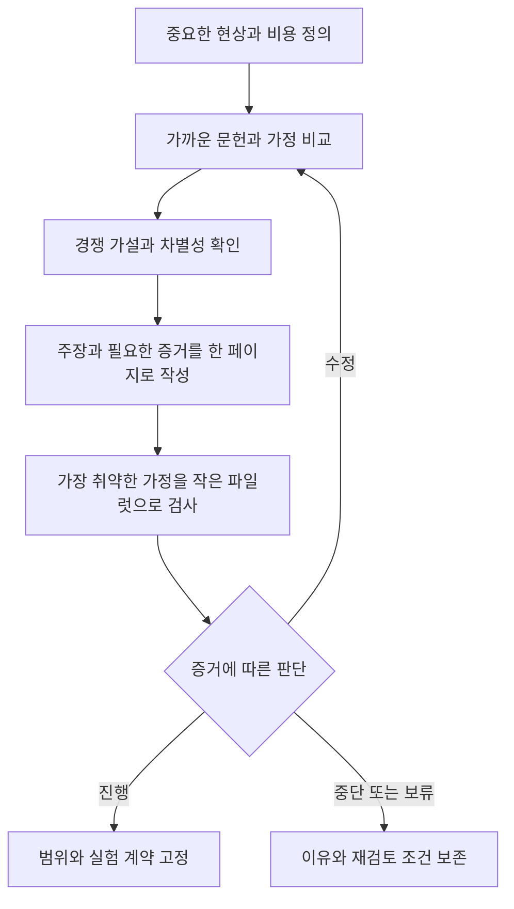

# 기존 논문에서 검증 가능한 연구 아이디어로: 본격 연구 전 빌드업 가이드

- 작성·웹 확인: **2026-10-19 KST**
- 대상: **VLA 기반으로 다양한 로봇의 manipulation·navigation을 다루는 연구**, 그리고 robot behavior에 기여하는 3D perception. 2026-10-21 최신 방향 탐색부터 RL은 필수 조건으로 두지 않는다.
- 목적: 큰 학습·시스템 구현에 투자하기 전에 **어떤 새로운 지식을 만들 수 있는지, 가장 취약한 가정이 무엇인지, 이를 어떻게 적은 비용으로 확인할지** 판단한다.
- 성격: 연구자의 공개 경험·교육 자료와 공식 학회·저널 지침을 조사한 방법론 문서. 아래 절차·양식·robotics 예시는 이를 저장소의 연구 방향에 맞게 구성한 **연구자 해석과 실무 제안**이다.

연구 착수 전 모든 결과를 알 수는 없다. 여기서 확인하려는 것은 논문 채택 가능성의 점수가 아니라, **중요한 질문이 있고, 기존 지식과의 차이가 설명되며, 실패해도 판단을 갱신할 수 있는 실험이 있는가**다. 작은 진단 실험은 이 빌드업 단계에 포함한다.

최신 적용 사례는 [E2 buildup](../work/research_candidates/2026-10-22_e2_buildup/README.md)이다. 기존 시간 표현·adaptive chunking·feedback 방법과 공개 controller 경로를 대조해 일반 신규 방법을 NO-GO, 통제 후 설계 판단이 달라지는지 묻는 진단을 REVISE/HOLD로 남겼다. 1–6 문헌/설계·7 해석적/source 검사·8 내부 판단까지 수행했으며 실제 정책 효과와 외부 연구자 피드백은 미완료다. 단계별 문서가 있다는 사실을 연구 기여의 입증으로 간주하지 않는다.

이전 [D1 buildup](../work/research_candidates/2026-10-21_d1_buildup/README.md)은 broad 원인 구별 주장을 식별 가능성·행동 관련성의 조건부 진단으로 수정한 사례다. 문헌과 Docker 합성 검사를 실제 VLA 효과와 구분했으며, 후속 판단과 현재 작업은 [TODO](../TODO.md)를 따른다.

이전 [C3 실행 행동과 RL update](../work/research_candidates/2026-10-21_execution_interface/README.md)에서는 native 함수의 mechanism 검사에 이어 실제 pretrained logits까지 측정했다. Gripper만 집계한 큰 상대 감소율이 전체 chunk에서는 작고 마지막 slot에 집중된다는 사실을 확인해 본격 학습 우선순위를 낮췄다. 현상의 존재, 실제 분포에서의 비중, 기존 이론과의 신규성, 정책 성능을 각각 따로 판정한 사례다.

2026-10-22 [D1 baseline 확보](../work/research_candidates/2026-10-21_d1_buildup/BASELINE_DOSSIER.md)는 실험을 제외하고도 2–6단계의 문헌·interface·경쟁 설명·비교 설계를 보강한 사례다. 실험 자원의 부재가 buildup 전체의 중단을 뜻하지 않으며, baseline 문헌 준비 완료를 연구 기여 입증으로 바꾸지 않는다.

같은 날의 [주장·증거 계약](../work/research_candidates/2026-10-21_d1_buildup/CLAIM_EVIDENCE_CONTRACT.md)은 단순 보정으로 충분한 특수 경우를 먼저 도출하고, 그 설명을 배제할 task·관측 조건과 기각 규칙을 정리했다. [방법 감사](../work/research_candidates/2026-10-21_d1_buildup/BASELINE_METHOD_AUDIT.md)는 공식 수식과 공개 코드도 다를 수 있음을 확인했다. 진행 상태와 바로 다음 행동은 [TODO](../TODO.md)에서 관리하며 실제 정책 검증·외부 피드백은 미완료다.

후속 [D1-L3](../work/research_candidates/2026-10-21_d1_buildup/TASK_OBSERVABILITY_AUDIT.md)는 packet에 입력이 있는지에서 멈추지 않고 모델의 값 사용·output/controller까지 추적했다. `pi05_libero`의 state-value 전제 실패로 primary를 수정했고, task 이름 대신 실제 성공 predicate를 읽어 absolute-orientation 주장을 좁혔다. Source 적합성 심사만으로도 불필요한 정책 실험을 제거할 수 있지만, 대체 후보의 유용성까지 입증한 것은 아니다.

[D1-L4 계약](../work/research_candidates/2026-10-21_d1_buildup/PRE_EXPERIMENT_CONTRACT.md)은 planned artifact를 실제 JSON spec으로 만들고, report 오류·물리 변화·shared reset·split·정보/계산 예산·기각 기준을 고정했다. Flat state에 fixture/controller memory가 모두 들어 있지 않음을 확인하여 paired reset 검증을 추가했다. 이로써 계획한 비실험 L1–L4를 종료하고, 다음 투자 판단을 native G0/G1과 실제 외부 피드백에 연결한다. 실행 불가능한 설계 spec은 runtime manifest나 정책 효과 evidence를 대신하지 않는다.

앞선 2026-10-21 적용 결과인 [C2 빌드업 1차 판단](../work/research_candidates/2026-10-20_vla_rl/C2_BUILDUP_RESULT.md)에서는 직접 충돌 문헌과 실제 데이터·Docker 전제를 확인했으며 완전한 label/coverage 및 native runtime이 성립하지 않아 당시 설계를 NO-GO로 종료했다. 부분 경유 supervision을 확인한 것과 RL의 정책 효과를 검증한 것은 다르다. C1은 [native probe](../work/experiments/vla_rl_active_handoff/RESULTS.md)에서 task competence를 확인하지 못해 큰 후속 실험을 보류했다. 이전 로봇 간 RL 전이와 지연 검토는 [핵심 결과·교훈](../work/experiments/vla_rl_cross_embodiment/RESULTS.md)으로 통합하고 종료했다. 아래 6절의 지연 예시는 선행 연구와의 충돌을 반영한 방법론 사례이며 활성 연구 제안이 아니다.

## 1. 조사 범위와 읽는 방법

이전 검토에서는 실행·재생 경로가 작동해도 학습 정책의 기본 능력이 확보되지 않아 주 가설을 시험하지 못했다. **문헌 검토, 설계 고정, 실행 가능성, 연구 가설의 실험 검증을 구별**해야 한다. 새 후보 역시 직접 충돌 연구와 공개 interface를 확인한 단계이며 성능·신규성 입증은 남아 있다.

연구자 본인의 글·강연, 저자들이 공개한 교재, 공식 심사·투고 지침을 우선했다. 성공한 연구자들의 경험담은 유용하지만, 특정 습관이 논문 성과를 인과적으로 높인다는 실증 연구는 아니다. 아래는 전 분야 연구자에 대한 체계적 조사나 모든 top-tier venue의 공통 규정이 아니다.

출처는 역할을 나눠 읽는다.

| 출처 유형 | 여기서 확인할 수 있는 것 | 해석의 경계 |
|---|---|---|
| 연구자의 공개 회고·조언 | 문제 선택, 읽기, 시행착오, 피드백에 대한 본인의 설명 | 모든 연구자의 실제 작업 과정으로 일반화하지 않는다 |
| 연구 교육 자료 | 가정을 점검하고 생각을 정리하는 재사용 가능한 도구 | 제시된 방법이 유일한 순서는 아니다 |
| 공식 학회·저널 지침 | 해당 venue·연도가 기대하는 기여와 증거의 종류 | 아이디어 단계의 채택 보장이나 자동 평가식이 아니다 |
| 완성된 논문 | 최종 주장·방법·실험과 선행 연구의 관계 | 저자가 처음 아이디어를 얻은 순서를 복원할 수는 없다 |

이 구분은 중요하다. Steinhardt는 완성된 논문만 읽으면 연구자의 사고 과정과 중간 판단이 잘 보이지 않는다고 설명한다. 따라서 논문의 논리 구조와 저자의 실제 발견 과정을 구분한다. [Jacob Steinhardt, *Film Study for Research*](https://jsteinhardt.stat.berkeley.edu/blog/film-study)

처음에는 2–4절로 판단 기준을 잡고, 실제 후보가 생기면 5–8절의 절차와 예시를 적용한다. 10절에는 복사해서 쓸 수 있는 검토 양식이 있다.

## 2. 연구자들은 무엇을 반복해서 하는가

### 2.1 Andrej Karpathy: 해결할 문제 자체를 고르는 능력을 훈련한다

Karpathy는 문제를 푸는 작업과 **어떤 문제가 중요하고 지금 풀 수 있는지 고르는 작업**을 구분한다. 자신의 박사과정 회고에서는 이미지와 언어의 연결에 관심을 갖게 된 이유로 남아 있는 질문의 폭, 설명 가능한 중요성, 당시 기술·데이터의 준비 상태 등을 든다. 이는 그가 직접 설명한 사례이지, 사후에 논문 제목에서 추정한 동기가 아니다. [*A Survival Guide to a PhD*, “Research topics”](https://karpathy.github.io/2016/09/07/phd/)

**여기서 적용할 습관:** 후보마다 “왜 중요한가?”와 “왜 지금 접근 가능한가?”를 따로 적는다. VLA 모델이 공개되었다는 사실은 실행 가능성의 근거가 될 수 있지만, 연구 질문의 중요성까지 설명하지는 않는다.

### 2.2 S. Keshav: 읽기 깊이를 나누고, 핵심 논문은 스스로 재구성한다

Keshav의 three-pass 방법은 전체 구조 파악, 내용 이해, 깊은 재구성으로 읽기를 나눈다. 마지막 단계에서는 저자의 가정 아래에서 논리를 스스로 다시 만들어 보며 숨은 가정과 약점을 찾는다. 여기서 말하는 virtual re-implementation은 반드시 코드를 모두 실행한다는 뜻은 아니다. [*How to Read a Paper*, §2–3, ACM SIGCOMM CCR, 2007; Waterloo 공개본](https://cs.uwaterloo.ca/~brecht/courses/854-http-video-2012/readings/keshav-paper-reading.pdf)

**여기서 적용할 습관:** 넓게 찾을 때는 후보를 선별하고, 아이디어와 직접 충돌하는 논문은 objective·input·action·evaluation을 재구성할 정도로 읽는다. 모든 registry 논문을 읽은 뒤에야 아이디어를 시작할 필요는 없다.

### 2.3 Torralba·Isola·Freeman: 작은 문제에서 가정과 실패 원인을 분리한다

세 저자의 교재는 연구가 잘되지 않는 이유가 구현 오류인지, 가정의 오류인지부터 구분해야 한다고 설명한다. 핵심을 보존한 toy model과 해석 가능한 실험을 강조한다. 색 항상성 문제를 관측값 `y = a × b`에서 두 요인을 추정하는 문제로 줄인 예는, 복잡한 파이프라인을 구현하기 전에 모호성을 드러내는 사고 실험이다. [*Foundations of Computer Vision*, §52.2](https://visionbook.mit.edu/how_to_do_research.html)

**여기서 적용할 습관:** “전체 VLA 시스템이 실패했다”를 “어느 관측 조건에서 어느 제어 결정이 실패했는가”로 줄인다. 단일 요인 실험으로 시작하되, 요인 간 상호작용이 핵심인 질문이라면 이후 factorial comparison도 설계한다.

### 2.4 Simon Peyton Jones: 쓰기를 통해 아이디어의 빈칸을 발견한다

Peyton Jones는 아이디어가 완성된 뒤 쓰기 시작하는 대신, 일찍 글을 써서 주장과 모르는 부분을 명확히 하고 비판을 받으라고 권한다. 기여는 독자가 이해할 수 있는 중심 아이디어로 정리하고, 각 주장에 필요한 증거를 연결한다. [저자 강연 페이지](https://simon.peytonjones.org/great-research-paper/), [공개 슬라이드, “Writing papers: model 2”·“The idea”·“Evidence”](https://www.microsoft.com/en-us/research/uploads/prod/2016/07/How-to-write-a-great-research-paper.pdf)

**여기서 적용할 습관:** 초기에는 한 페이지로 문제·가설·차이·필요한 실험을 쓴다. 결과가 없는 부분은 예상 또는 미확인으로 표시한다. 글을 자연스럽게 만들기 위해 결과가 이미 나온 것처럼 작성하지 않는다.

### 2.5 Jacob Steinhardt: 다른 연구자의 판단과 자신의 판단을 비교한다

Steinhardt가 제안하는 film study와 act–reflect–ask는 좋은 결과만 수집하기보다, 어떤 판단을 했고 무엇을 놓쳤는지 복기하는 습관이다. 연구자의 공개 글, 토론, 멘토의 사고 과정을 통해 판단 전략을 배울 수 있다고 설명한다. [*Film Study for Research*, “Film Study”·“Act-Reflect-Ask”](https://jsteinhardt.stat.berkeley.edu/blog/film-study)

**여기서 적용할 습관:** 논문의 방법·결과를 보기 전에 “내가 저자라면 무엇을 먼저 확인할까?”를 적고, 실제 선택과 비교한다. 이는 이 문서에서 제안하는 연습이다. 저자의 내적 동기를 사실처럼 쓰지 말고, 왜 특정 실험이 필요했는지에 대한 자신의 설명을 기록한다.

### 2.6 실제 회고에서 얻을 수 있는 빌드업의 모양

Karpathy의 사례에서 배울 부분은 특정 분야 조합 자체보다 **질문의 중요성, 후속 질문의 여지, 실행을 가능하게 한 조건을 함께 판단했다는 점**이다. Freeman 등이 소개한 toy model에서는 **관측과 숨은 요인 사이의 모호성을 작은 문제로 드러내는 방식**을 볼 수 있다. 이 두 사례를 종합하면 문제를 고르는 판단과 문제를 검증 가능한 크기로 줄이는 판단이 함께 필요하다. 이는 위 회고·교재를 현재 연구에 적용한 해석이며, 두 연구가 동일한 절차를 따랐다는 뜻은 아니다.

## 3. Top-tier 기준을 아이디어 단계의 질문으로 바꾸기

학회 이름을 목표로 정하는 것만으로 연구 가치를 판별할 수 없다. 아래는 공식 지침에서 확인한 기준과, 그 기준을 초기 검토에 적용한 질문이다.

| 공식 출처 | 확인한 기준 | 초기 검토에 적용할 질문 |
|---|---|---|
| [ICLR 2026 Reviewer Guide](https://iclr.cc/Conferences/2026/ReviewerGuide) | 구체적 문제, 문헌 속 동기, 주장에 대한 엄밀한 증거, 공동체에 주는 새로운 지식과 가치. SOTA가 필수는 아님 | 성공하면 기존에 몰랐던 무엇을 알게 되는가? 이를 보여 줄 비교가 있는가? |
| [NeurIPS 2026 Evaluations & Datasets 지침](https://neurips.cc/Conferences/2026/EvaluationsDatasetsReviewerGuidelines) | 기여 유형에 맞는 quality·clarity·significance·originality. 기존 평가의 한계와 negative result도 체계적으로 검증하면 가치가 있음 | 새 알고리즘이 없어도 평가 관행이나 기존 결론을 바꾸는가? 부정 결과를 설명할 통제가 있는가? |
| [RSS 2026 Call for Papers](https://roboticsconference.org/2026/information/cfp/) | 새로운 scientific contribution과 systems contribution을 모두 모집 | 시스템 통합을 통해 어떤 새로운 robot capability 또는 재사용 가능한 설계 지식을 입증하는가? |
| [IEEE T-RO Information for Authors](https://www.ieee-ras.org/publications/t-ro/t-ro-information-for-authors/) | 독창적이고 중요한 결과. 기존 연구의 증명·실험·설명을 단순히 늘리는 것 이상의 기여 요구 | 추가 구현·실험의 양을 제외해도 새로운 주장과 실질적인 발전이 남는가? |

NeurIPS 항목은 **E&D track**의 지침이다. 이를 모든 트랙의 동일한 평가 규정으로 일반화하지 않는다. RSS는 연도별 페이지를 사용했다. 공식 웹사이트의 최신 연도 페이지와 과거 검색 색인이 다를 수 있으므로 실제 페이지의 연도를 확인한다.

이 기준을 종합해 후보를 다음 다섯 축으로 검토한다. 점수를 합산하는 채택 예측식은 사용하지 않는다.

1. **중요성:** 이 문제가 해결되면 누구의 어떤 판단·능력·비용이 달라지는가?
2. **차별성:** 가장 가까운 선행 연구와 비교해 질문, 조건, 방법, 설명 중 무엇이 달라지는가?
3. **검증 가능성:** 가설이 틀렸을 때 나타날 결과가 정의되어 있는가?
4. **실행 가능성:** 데이터·환경·관측·기반 코드·예산으로 결정적인 비교를 할 수 있는가?
5. **재사용 가능성:** 특정 checkpoint·장면을 넘어 다른 연구자가 활용할 지식이나 도구가 남는가?

예컨대 새 모듈의 성능 향상이 있어도 중요성과 차별성이 약할 수 있다. 반대로 단순한 방법이라도 기존 설명을 교정하거나 비용 제약 아래 가능한 행동을 바꾸면 검토할 가치가 있다. 기여의 크기는 후속 증거로 판단한다.

## 4. 주제, 질문, 가설, 기여를 분리하기

| 구분 | 예시 — 아직 검증되지 않은 설명용 후보 | 다음에 필요한 것 |
|---|---|---|
| 주제 | VLA + RL로 manipulation을 개선한다 | 실패 조건과 관심 결과를 좁힌다 |
| 문제 현상 | 관측 이후 물체 상태가 바뀔 때, 실행 중인 action chunk의 성공률이 낮아지는가? | 현상이 실제로 있는지 확인한다 |
| 연구 질문 | 같은 추론 예산에서 언제 다시 관측하고 action을 갱신해야 하는가? | 선행 연구가 이미 답한 범위를 조사한다 |
| 가설 | 평균 chunk 길이보다 상태 변화 시점과 갱신 시점의 정렬이 일부 실패를 더 잘 설명한다 | 경쟁 설명과 구별할 intervention을 설계한다 |
| 방법 후보 | 제한된 action 갱신 예산을 상태 변화 신호에 따라 배분한다 | 단순한 주기 조정·threshold 정책과 비교한다 |
| 기여 후보 | 특정 변화 조건에서 갱신 시점의 효과와 비용을 분리하는 평가·설계 지식 | 실제 결과와 선행 연구 대비 차이가 필요하다 |

이 예시는 신규성을 주장하지 않는다. 특히 action chunk 길이와 반응성은 이미 연구된 문제다. 핵심은 알고리즘 이름을 먼저 고정하지 않고, **문제의 존재 → 설명 → 필요한 개입**으로 구체화하는 것이다.

## 5. 문헌에서 아이디어로 넘어가는 8단계

이 단계는 조언을 종합한 실무 절차다. 앞 단계의 가정이 깨지면 돌아간다. 실험 결과와 문헌 조사는 서로를 계속 수정한다.



### 단계 1. 해결되면 달라질 일을 먼저 적는다

한 문장에 **사용자/로봇, 조건, 실패 또는 비용, 개선의 의미**를 넣는다. “generalization이 부족하다”보다 “관측 시야 밖에서 물체 위치가 바뀐 뒤 다시 접근할 때, 오래된 위치 기억 때문에 잘못된 접근 행동을 선택하는가?”가 검사하기 쉽다.

DARPA의 Heilmeier 질문은 목표, 현재 접근과 한계, 새 접근의 이유, 성공의 의미, 위험, 비용, 기간, 중간·최종 검증을 묻는다. 여기서는 연구 프로그램 제안 도구를 작은 연구 후보의 점검에 적용한다. 학회 심사표는 아니다. [DARPA, *The Heilmeier Catechism*](https://www.darpa.mil/about/heilmeier-catechism)

**산출물:** 문제 한 문장 + 중요성을 뒷받침할 source/관측 + 아직 확인하지 못한 부분. 논문이 보고한 제한과 내가 예상하는 실패를 별도 표시한다.

### 단계 2. 질문을 판단하는 데 필요한 문헌 집합을 만든다

다음 역할을 채우는 논문을 찾는다. 편수 quota는 두지 않는다.

- 문제·objective·표현을 만든 foundation.
- 같은 조건과 주장을 다루는 가장 가까운 방법.
- 제안 방법 없이도 답할 수 있는 강한 단순 baseline.
- 주장의 성립 조건을 시험할 benchmark·dataset·evaluation protocol.
- 내 해석과 반대되는 결과, 다른 원인 설명, 실패 또는 재현 연구.

처음에는 abstract·그림·관련 연구로 범위를 좁히고, 직접 경쟁하는 논문은 본문·부록·공개 code의 interface를 확인한다. 최신성 검색은 최근 3개 calendar year를 우선하되, 핵심 메커니즘은 과거와 인접 분야까지 추적한다.

**잠정적으로 탐색을 멈출 조건:** 가까운 방법들의 계보와 차이가 설명되고, 새 검색 결과가 이미 알고 있는 family로 수렴하며, 미확인 문헌을 명시할 수 있을 때다. 검색이 포화되었다는 판단도 잠정적이다. 큰 학습 직전과 논문 주장 확정 전에 다시 확인한다.

### 단계 3. 요약 대신 가정·interface·증거를 비교한다

각 행은 논문 하나이며, 확인되지 않은 칸은 비워 두거나 `확인 필요`로 기록한다.

| 논문·source anchor | 문제/적용 조건 | policy-visible input·state | action·결정 시점 | 학습 신호·데이터 | 성립에 필요한 가정 | 실제 평가·baseline | 아직 답하지 않은 질문 |
|---|---|---|---|---|---|---|---|
| 제목, §/표/그림/code 위치 | 조건을 구체화 | GT와 추정값 구분 | 실행 길이·feedback·memory | supervision·reward·예산 | 관측 가능성·정확도·정적 환경 등 | split·metric·실패 범위 | 저자 한계 / 내 추론 구분 |

표를 채운 뒤 “A보다 B가 좋다”보다 **A와 B가 실제로 같은 문제를 풀고 있는가?**를 먼저 확인한다. 정보량·demonstration·interaction·추론 예산·robot embodiment가 다르면 성능 숫자를 바로 비교하지 않는다.

### 단계 4. 비어 있는 칸을 연구 질문으로 바꾼다

문헌에 없다는 이유만으로 가치가 생기지는 않는다. 다음 유형을 출발점으로 삼고, 그 빈칸이 robot behavior를 어떻게 제한하는지 설명한다.

| 문헌에서 발견한 패턴 | 만들 수 있는 질문 | 먼저 배제할 쉬운 설명 |
|---|---|---|
| 여러 방법이 같은 강한 가정을 둠 | 그 가정이 깨질 때 성능·안전의 경계는 어디인가? | 환경 설정이나 구현 오류 |
| 비슷한 주장에 결과가 상충함 | 데이터·정보·예산 차이가 결론을 바꾸는가? | baseline tuning과 split 불일치 |
| representation 점수는 좋아지지만 행동은 그대로임 | 어떤 오차가 실제 action choice를 바꾸는가? | downstream policy가 새 표현을 사용하지 못함 |
| planner와 controller 사이에서 실패가 집중됨 | 결정 시간척도나 상태 전달이 병목인가? | 센서 지연·timestamp·coordinate 오류 |
| 평균 성능이 특정 실패를 가림 | 기존 metric이 무엇을 놓치며 결론이 바뀌는가? | 드물고 중요하지 않은 사례만 선별함 |
| 새로운 센서·데이터·기반 모델을 사용할 수 있음 | 이전에는 검증 불가능했던 어떤 질문이 이제 가능한가? | 기존 방법에 자원만 추가한 효과 |

이때 **가설 H1과 경쟁 설명 H0/H2**를 함께 작성한다. 예: 실패 원인이 feedback 시점인지, observation 품질인지, 학습 데이터 coverage인지 분리한다. 한 가설이 지지되지 않았다는 사실만으로 다른 가설이 참이라고 결론 내리지 않는다.

### 단계 5. 가장 가까운 선행 연구와 정면으로 비교한다

검색어에는 모델 이름뿐 아니라 메커니즘의 동의어를 넣는다. 예를 들어 action 갱신 문제라면 `action chunking`, `receding horizon`, `reactive policy`, `event-triggered control`, `adaptive horizon`, `temporal abstraction`까지 확인한다. VLA 논문 안에서만 검색하면 control·RL의 기존 개념을 놓칠 수 있다.

후보마다 다음을 기록한다.

1. 가장 가까운 논문과 최신 후속 연구의 정확한 식별자·version·공식 source.
2. 그 연구가 이미 해결한 질문과 적용 조건.
3. 내 후보와 **같은 부분**, 실제로 다른 부분, 아직 대조하지 못한 부분.
4. 그 논문에 충분한 tuning이나 간단한 수정만 해도 내 결과가 나올 가능성.
5. 차이가 있어도 그 차이가 중요한 이유.

Top-tier 논문을 중심으로 읽되 novelty 검색에는 최신 preprint도 포함한다. Preprint와 accepted status는 구별한다. “찾지 못했다”는 결과를 “아무도 하지 않았다”로 바꾸지 않는다.

**산출물:** closest-work 비교표와 잠정 novelty 문장. 직접 충돌하는 논문의 본문·공개 interface 확인이 끝나지 않았으면 대규모 구현 착수 조건을 충족한 것으로 보지 않는다.

### 단계 6. 방법보다 먼저 주장–증거 연결을 쓴다

한 페이지 초안에 다음 질문을 연결한다.

- 기존에는 무엇을 알고 있었는가?
- 어떤 조건에서 그 지식만으로는 판단하기 어려운가?
- 새로 검증할 주장은 무엇인가?
- 어떤 결과가 나오면 그 주장을 줄이거나 버려야 하는가?
- 독자가 재사용할 것은 알고리즘, 설명, 경계 조건, 평가 도구 중 무엇인가?

| 잠정 주장 | 필요한 증거 | 반대 설명 | 구별할 비교 | 현재 상태 |
|---|---|---|---|---|
| 한 문장에 한 주장 | 관측·분석·실험·증명 중 적합한 것 | 가장 설득력 있는 대안 | 결과에 따라 판단이 달라지는 비교 | 미실행 / 예비 결과 / 검증 완료의 실제 범위 |

예상 결과표를 만들 때 숫자는 채우지 않는다. 열·조건·metric과 가설별 방향만 적는다. 이 표의 목적은 긍정적인 결과를 약속하는 것이 아니라, **어떤 결과를 얻어도 해석할 준비를 하는 것**이다.

### 단계 7. 가장 취약한 연결부터 저비용으로 검사한다

다음 중 현재 불확실성을 가장 많이 줄이는 검사를 선택한다. 모든 후보가 순서대로 전부 수행할 필요는 없다.

| 검사 | 확인할 것 | 결과의 한계 |
|---|---|---|
| 논리적 counterexample·toy problem | 문제 formulation의 모순, 필요한 정보, 비식별성 | toy에서의 성립이 real-robot 성립을 보장하지 않음 |
| 기존 결과·로그 재분석 | 현상 빈도, failure stratum, metric의 누락 | 기록된 정책 밖의 counterfactual action 결과는 알 수 없음 |
| 단순 baseline | tuning, 주기 변경, 규칙만으로 충분한지 | 부실하게 조정한 baseline의 실패는 새 방법의 근거가 아님 |
| privileged diagnostic comparator | 정확한 상태·이벤트를 알 때 개선 여지가 있는지 | 추가 정보를 쓰면 배포 가능한 공정 baseline이나 수학적 상한이 아님 |
| 작은 closed-loop 실험 | 실제 관측–행동 변화가 결과를 바꾸는지 | 소수 장면·seed 결과로 일반화를 주장할 수 없음 |
| input availability·latency 검사 | 필요한 신호를 필요한 시점에 얻을 수 있는지 | 오프라인의 좋은 추정 성능만으로 실시간 가능성을 판단하지 않음 |

시간·compute를 더 쓰기 전에 **어느 결과가 나오면 다음 결정을 바꿀지** 적는다. 다양한 모델을 무작정 돌려서 좋은 숫자를 찾는 것은 이 단계의 대체물이 아니다.

### 단계 8. 외부 비판을 받고 진행·수정·중단을 결정한다

지도교수나 동료에게 긴 아이디어 목록보다 문제 한 문장, closest-work 비교, 가장 중요한 예비 증거, 다음 실험을 보여 준다. “괜찮아 보이나요?” 대신 다음 질문으로 피드백을 요청한다.

- 이 주장을 이미 설명한 가장 가까운 논문은 무엇인가?
- 문제의 중요성에 동의하지 않는다면 어떤 근거가 부족한가?
- 제안한 실험이 배제하지 못하는 대안 설명은 무엇인가?
- 추가 정보·데이터·추론 예산을 은근히 더 쓰고 있지는 않은가?
- 가장 저렴하게 이 가설을 틀렸다고 보여 줄 실험은 무엇인가?
- 결과가 모두 예상대로 나와도 독자에게 남는 새 지식이 약한가?

피드백은 문헌 확인, 가설 수정, 실험 변경 중 구체적인 행동으로 기록한다. 전문가의 기대는 유용한 prior이며 최종 증거를 대신하지 않는다.

## 6. VLA + RL manipulation 예시: 아이디어를 좁혀 가는 과정

**아래는 절차 설명용 가상 사례다. 실제 pilot 결과도, 신규성이 확인된 프로젝트도 아니다.** 환경·checkpoint·trial 수·budget은 아직 정하지 않았으므로 실행 명세로 사용할 수 없다.

### 6.1 출발점과 충돌하는 기존 연구

출발 문장: “VLA에 RL과 adaptive action chunk를 붙여서 더 reactive하게 만들자.”

이 문장만으로는 무엇이 새롭고 무엇을 검증할지 알 수 없다. 저장소에도 [Q-chunking](../2025/NeurIPS/2025_NeurIPS_Reinforcement-Learning-with-Action-Chunking/01_overview.md), [Decoupled Q-Chunking](../2026/ICLR/2026_ICLR_Decoupled-Q-Chunking/01_overview.md), [OpenVLA-OFT](../2025/RSS/2025_RSS_Fine-Tuning-Vision-Language-Action-Models-Optimizing-Speed/01_overview.md)가 있으므로 우선 비교해야 한다.

특히 DQC의 공개 자료는 critic과 actor의 chunk 길이를 분리하는 접근을 설명한다. 따라서 “긴 value horizon과 짧은 action horizon을 분리한다”는 발상만을 새 기여로 삼을 수는 없다. [DQC 저자 공개 repository](https://github.com/ColinQiyangLi/dqc). 이 문서에서 DQC의 모든 실험·코드를 정독하거나 실행한 것은 아니며, 저장소 note도 `ABSTRACT_CHECKED`다. contact 조건이나 event-triggered 실행과의 정확한 차이는 **본문·interface 확인 필요**다.

### 6.2 질문을 좁힌다

잠정 질문: **외부 변화가 있는 manipulation에서, 같은 추론 자원 제약 아래 action 갱신 시점이 recovery에 주는 효과를 평균 실행 길이·관측 품질의 효과와 구분할 수 있는가?**

| 경쟁 가설 | 구별에 도움이 될 관측·개입 |
|---|---|
| H1: 중요한 변화 직후에 갱신하지 못하는 것이 병목 | 동일한 평균 호출 예산에서 변화 시점에 맞춘 갱신과 주기적 갱신의 차이 |
| H2: 관측이나 상태 추정 자체가 부정확한 것이 병목 | 갱신 시점이 같을 때 관측 품질을 바꾸는 진단 비교 |
| H3: 정책이 해당 상태에서 복구 행동을 학습하지 못함 | 정확한 정보와 빠른 갱신을 제공해도 개선되지 않는 조건의 분석 |

H3의 증거를 얻으려면 행동 능력과 데이터 coverage도 별도로 확인해야 한다. H1이 지지되지 않았다는 결과만으로 H3를 확정하지 않는다.

### 6.3 새 RL 학습 전에 할 검사

1. 기존 policy의 입력·출력·timestamp·action 실행을 확인한다. 성공하는 nominal condition을 확보한 뒤 외부 변화 조건에서 실패가 반복되는지 본다.
2. 고정된 checkpoint로 실행 길이·관측 지연·외부 변화 시점을 조절한다. 이는 해당 policy의 작동 원인을 진단하는 실험이며, 각 method family의 최적 성능 비교와 구별한다.
3. 같은 action 후보와 실제 가용 신호를 사용하는 주기적 갱신·간단한 threshold 규칙을 비교한다. 신호 계산 비용도 포함한다.
4. 정확한 이벤트 시점을 주는 privileged comparator로 개선 여지를 진단한다. 이를 배포 가능한 경쟁 baseline과 섞어 순위를 매기지 않는다.
5. 개선 여지가 있으면 그 이벤트를 실제 관측으로 제때 탐지할 수 있는지 확인한다. 그 뒤에야 학습할 결정이 남아 있는지 판단한다.

기존 로그의 action을 다른 것으로 바꿔 끼운 재생만으로는 새로운 closed-loop 결과를 알 수 없다. 행동이 다음 관측을 바꾸는 비교는 simulator 또는 실제 상호작용이 필요하다. 이 단계에서 로봇·센서·RL·world model을 동시에 새로 도입하면 원인 구분이 어려워진다.

### 6.4 공정성과 측정 계약

- **자원:** 호출 수만 맞추지 말고 model compute, sensor 처리, controller overhead, wall-clock latency를 함께 기록한다. 하나의 예산으로 정렬되지 않으면 성능–비용 곡선을 비교한다.
- **정보:** policy-visible input과 privileged information을 명시한다. 미래 상태·정답 이벤트를 쓰는 진단 비교는 별도 표시한다.
- **학습:** 새 RL을 도입할 때는 demonstration, environment interaction, reward, reset·human intervention 예산을 정렬하거나 차이를 보고한다.
- **결과:** 전체 성공률, 사전에 정의한 변화 조건별 성공·복구 시간, task에 맞는 contact/collision 지표를 기록한다. 좋은 장면만 골라 평균내지 않는다.
- **변동:** paired scenario를 사용할 수 있으면 조건을 맞추고, seed·episode·task를 구분한다. 영상 frame을 독립 trial처럼 세지 않는다. pilot에서 변동을 추정한 뒤 본 실험 규모를 정한다.
- **외삽:** 하나의 checkpoint에서 얻은 결과의 범위와, 다른 policy·task·hardware에서 확인해야 할 범위를 나눈다.

### 6.5 결과별 판단을 미리 적는다

| 파일럿 결과 — 모두 가정적 상황 | 합리적인 다음 행동 |
|---|---|
| nominal 동작부터 재현되지 않음 | 환경·interface·baseline을 수정한다. 연구 가설의 반증으로 해석하지 않는다 |
| 작은 주기 조정만으로 현상이 대부분 해소됨 | 복잡한 learned scheduler의 필요성을 재검토한다. 단순 baseline의 강점을 보고한다 |
| privileged comparator에도 개선 여지가 거의 없음 | 현재 action set과 조건에서 timing 가설의 우선순위를 낮춘다. 다른 병목은 별도 검사한다 |
| privileged comparator만 좋고 가용 관측으로 이벤트를 구분할 수 없음 | 정보 가정부터 수정하거나 문제 범위를 줄인다 |
| 실제 신호를 쓰는 단순 규칙도 예산 내에서 효과가 있음 | 설명·일반화·기존 연구 대비 차이를 확인한다. RL이 필요한지는 별도 질문이다 |
| 적절한 baseline과 문헌 비교 후에도 새 조건·설명이 남음 | 가장 작은 학습 후보를 구현하고 holdout 조건에서 검사할 명세를 작성한다 |

긍정적인 pilot도 논문 기여의 확정은 아니다. 반대로 단순 규칙이 잘된 결과가 자동으로 실패한 프로젝트도 아니다. 어떤 기존 믿음이나 설계 선택을 바꾸는지, 그 지식이 이미 알려져 있는지에 따라 후속 방향을 정한다.

## 7. Navigation·3D로 옮겨 적용하기

아래도 **미검증 질문의 예시**다. 해당 분야의 미해결 문제라는 판정을 내린 것이 아니다.

| 방향 | 막연한 출발 | 더 좁은 질문 | 먼저 할 진단 | 주의할 대안 설명 |
|---|---|---|---|---|
| Navigation memory | VLA에 spatial memory를 추가한다 | 재방문 시 이전 기억의 내용 오류와 localization 오차가 잘못된 경로 선택에 각각 얼마나 기여하는가? | 작은 환경에서 기억 상태와 localization 품질을 독립적으로 조절하고 정책 선택을 비교 | 기억 길이보다 pose·timestamp 오류가 원인일 수 있음 |
| Navigation + RL | 장기 navigation을 RL로 개선한다 | 동일한 interaction budget에서 개선이 탐색·복구·instruction 해석 중 어디서 발생하는가? | 실패 유형을 정의하고 고정 baseline의 결과를 유형별 분석 | 더 많은 데이터나 쉬운 scenario 구성의 효과일 수 있음 |
| Robotics-enabling 3D | 더 정확한 reconstruction을 VLA에 넣는다 | 어떤 공간 오차가 collision·grasp approach의 행동 결정을 실제로 바꾸는가? | policy와 관측 조건을 고정하고 task 관련 공간 오차를 통제해서 주입 | 전체 geometry metric의 향상과 task 관련 정보의 향상이 다를 수 있음 |

Navigation은 [navigation 관련 registry](../PAPER.md)와 [VLA synthesis](../synthesis/04_vla_generalist.md), [world-model·recovery synthesis](../synthesis/05_world_models_safety.md)를 함께 본다. 3D는 [robotics 3D synthesis](../synthesis/07_robotics_3d_perception.md)에서 표현과 행동의 연결을 확인한다. 현재 registry에 있다는 사실은 이 예시의 novelty 검토가 완료되었다는 의미가 아니다.

## 8. 진행·수정·중단 기준

다음은 연구 투자 결정을 위한 제안이다. 각 항목을 `근거 있음 / 미확인 / 반대 근거 있음`으로 기록하고 source를 붙인다. 점수 합으로 약점을 숨기지 않는다.

| 검사 | 진행할 근거 | 수정·보류할 신호 |
|---|---|---|
| 문제의 존재와 중요성 | 실제 조건에서 관측되거나 명확한 이론적·문헌적 근거가 있음 | 제목·직감·고른 실패 영상만 있음 |
| 선행 연구와의 차이 | 가까운 연구가 답한 범위와 남은 차이가 구체적임 | 이름만 다른 기존 메커니즘이거나 직접 경쟁 연구를 확인하지 않음 |
| 가설의 식별 가능성 | 적어도 하나의 비교에서 경쟁 설명들의 예측이 달라짐 | 어떤 결과가 나와도 같은 주장으로 해석함 |
| 개선 여지 또는 설명의 가치 | 제안 intervention의 효과를 볼 여지가 있거나 중요한 기존 결론을 검증함 | baseline 오류를 고치면 질문 자체가 사라짐 |
| 실행 조건 | 필요한 정보·환경·자원과 첫 실험의 경로가 확인됨 | 현재 얻을 수 없는 신호나 재현 불가능한 기반에 전적으로 의존함 |
| 기여의 범위 | 다른 연구자가 재사용할 주장·조건·artifact를 설명할 수 있음 | 특정 장면·checkpoint의 tuning 성공만 남음 |

- **진행:** 중요한 불확실성이 충분히 줄었고, 다음 비용을 쓰면 무엇을 알게 되는지 분명하다. 이제 scoped project 명세를 작성한다.
- **수정:** 질문은 중요하지만 가설·센서 가정·baseline·실험 설계 중 일부가 맞지 않는다. 실패한 연결을 고치고 작은 검사를 반복한다.
- **중단 또는 보류:** 이미 해결된 문제이거나, 새 지식이 약하거나, 현재 자원으로 구별할 검사가 없다. 이유와 재검토할 조건을 남긴다.

Negative result를 남길 때도 contribution audit가 필요하다. 부실한 구현이나 한두 조건의 실패와, 잘 통제된 조건에서 기존 평가 결론의 한계를 밝힌 결과는 다르다. [NeurIPS 2026 E&D, “Reproducibility, Auditing, and Stress-Testing of Evaluations”](https://neurips.cc/Conferences/2026/EvaluationsDatasetsReviewerGuidelines)

## 9. 빌드업 과정에서 자주 생기는 오판

| 오판 | 교정할 행동 |
|---|---|
| A + B 조합을 아직 못 봤으니 새롭다 | 기능·objective·정보 흐름이 같은 기존 방법을 다른 분야까지 검색한다 |
| 최근 top-tier 논문이니 그 후속이면 중요하다 | 그 연구가 남긴 질문이 현재 robot behavior의 병목인지 확인한다 |
| limitation 문장 하나가 곧 연구 gap이다 | 왜 그 한계가 중요하고 다른 논문에서도 해결되지 않았는지 확인한다 |
| baseline보다 높으면 원인 설명도 맞다 | 대안 설명을 분리하는 intervention·control을 추가한다 |
| ablation을 많이 하면 기여가 강해진다 | 각 ablation이 어느 주장과 경쟁 설명을 구별하는지 연결한다 |
| 작은 pilot이 좋으니 일반화가 확인됐다 | pilot은 다음 단계 투자 판단에 사용하고 별도 holdout에서 확인한다 |
| 실패 결과는 버리고 다음 아이디어로 간다 | 무엇이 반증되었고 무엇은 아직 모르는지 기록한다 |
| 지도교수가 좋아하니 검증은 끝났다 | 흥미·문헌·실행 가능성·증거에 대한 피드백을 나누어 기록한다 |
| 문헌을 충분히 읽을 때까지 실험을 미룬다 | 현재 판단을 바꿀 질문에 한정해 읽기와 작은 검사를 왕복한다 |

## 10. 복사해서 쓰는 아이디어 검토 양식

한 페이지로 시작하되 source anchor와 실험 설계는 필요에 따라 늘린다. 대괄호 항목은 미작성 필드이며 완료된 artifact를 뜻하지 않는다.

```markdown
# 후보명

- 작성일 / 마지막 문헌 검색일:
- 현재 결정: 탐색 / 파일럿 / 진행 / 수정 / 보류
- 이번 검토의 핵심 불확실성:

## 문제와 가치
- 조건·로봇·실패/비용을 포함한 문제 한 문장:
- 해결되면 바뀔 행동·비용·설계 결정:
- 문제 존재의 근거: [source + section/table 또는 실제 관측 기록]
- 아직 관측하지 않은 예상 현상:
- 왜 지금 실행 가능한가:

## 문헌과 차이
- Foundation / closest methods / simple baseline / evaluation resource:
- 각 직접 경쟁 연구: [정확한 ID/version, source anchor, 확인한 code interface]
- 기존 연구와 같은 부분:
- 실제로 다른 질문·조건·메커니즘·설명:
- 그 차이가 중요한 이유:
- 신규성을 무너뜨릴 수 있는 미확인 문헌:

## 가설과 반증
- H1:
- 가장 강한 경쟁 설명 H0/H2:
- 예측이 달라지는 조건:
- H1을 버리거나 줄일 결과:
- 성공 시 남는 새 지식:

## 최소 검사 — 계획과 완료를 분리
- 검사 목적 / 아직 실행하지 않은 단계:
- 환경·task·checkpoint·code commit:
- policy-visible input / privileged diagnostic input:
- action·option·결정 시점·control interface:
- baseline과 tuning 범위:
- 고정할 조건 / 조절할 조건:
- data·interaction·inference·human intervention 예산:
- primary metric / 실질적으로 의미 있는 차이 / 그 근거:
- 실패·timeout·reset 집계 방법:
- split·seed·독립 관측 단위·변동 확인 방법:
- 어떤 결과에서 진행 / 수정 / 중단할지:
- 예상 실행 시간·자원 / 비용 상한:
- 아직 없는 manifest·code·report:

## 결과와 피드백 — 실행 후에만 작성
- 실제 실행한 설정·artifact 위치:
- 관측 결과와 불확실성:
- 예측과 달랐던 점:
- 배제된 설명 / 아직 남은 설명:
- 동료가 지적한 가장 강한 반론:
- 결정·이유·다음 검증·재검토 조건:
```

형식적인 칸 채우기보다 **가장 취약한 주장 하나와 그것을 시험할 검사 하나**가 분명한지가 중요하다. 비용·효과 기준은 결과를 본 뒤 유리하게 바꾸지 말고, 바꿔야 한다면 변경 이유와 검증용 조건을 남긴다.

## 11. 이 저장소에서 사용하는 방식

읽기 우선순위는 계속 [READING_PLAN.md](./READING_PLAN.md)에서 관리한다. 이 문서는 별도의 CORE/NEXT 목록이나 프로젝트 우선순위를 만들지 않는다.

1. `02_problem.md`에서 문제와 가정, `03_method.md`에서 실제 interface, `04_evaluation.md`에서 증거의 범위를 확인한다.
2. `05_insights.md`의 **Paper-supported conclusion**과 **Researcher interpretation**을 나누어 후보 질문을 기록한다.
3. 같은 주장의 문헌을 [synthesis](../synthesis/README.md)에서 비교하고, source anchor를 갖춘 차이와 open question을 남긴다. 자동 queue와 미검증 seed를 정독 결과로 쓰지 않는다.
4. 후보가 생기면 이 문서의 양식으로 검토한다. 기존 삭제된 gap/idea register나 retired project를 자동으로 활성화하지 않는다.
5. 본격 구현으로 넘어갈 때 [AGENTS.md](../AGENTS.md)의 scoped project gate에 따라 환경·checkpoint·입출력·baseline·예산·metric·reject rule을 구체화한다. 작성 예정인 manifest와 실제 생성·검증한 artifact를 구분한다.

이 가이드 작성, 자동 요약, 검색 결과 수집은 사용자의 정독 상태를 올리는 근거가 아니다. 실제 상태 전환은 [READING_STATUS.md](./READING_STATUS.md)를 따른다.

## 12. 확인한 주요 원자료

모두 2026-10-19에 웹 자료를 확인했다. 연구 조언은 오래되었더라도 방법론 자료로 사용했고, 공식 venue 기준은 아래 명시한 연도·페이지에 한정한다. 강연 영상 전체 시청이나 연구자 인터뷰를 수행한 조사는 아니다.

| 자료 | 저자·기관 / 확인 범위 | 이 문서에서 사용한 부분 |
|---|---|---|
| [A Survival Guide to a PhD](https://karpathy.github.io/2016/09/07/phd/) | Andrej Karpathy, 2016; 본인 블로그의 Research topics 및 회고 | 문제 선택과 실제 관심 분야 전환 사례 |
| [How to Read a Paper](https://cs.uwaterloo.ca/~brecht/courses/854-http-video-2012/readings/keshav-paper-reading.pdf) | S. Keshav, ACM SIGCOMM CCR 37(3), 2007; Waterloo의 2쪽 공개 원문 | 단계별 읽기와 가정·논리 재구성 |
| [How to Do Research](https://visionbook.mit.edu/how_to_do_research.html) | Antonio Torralba·Phillip Isola·William T. Freeman; 공개 교재 52장 | 가정 검사, toy model, 연구 디버깅 |
| [How to Write a Great Research Paper](https://simon.peytonjones.org/great-research-paper/) | Simon Peyton Jones; 저자 페이지와 연결된 공개 슬라이드 | 초기 쓰기, 중심 주장, 주장에 대응하는 증거 |
| [Film Study for Research](https://jsteinhardt.stat.berkeley.edu/blog/film-study) | Jacob Steinhardt, 2021; 본인 글 | 사고 과정 학습과 판단 복기 |
| [The Heilmeier Catechism](https://www.darpa.mil/about/heilmeier-catechism) | DARPA 공식 페이지 | 중요성·기존 접근·위험·비용·검증을 연결하는 질문 |
| [ICLR 2026 Reviewer Guide](https://iclr.cc/Conferences/2026/ReviewerGuide) | ICLR 공식 지침, Review Content | 지식·가치·문헌적 동기·주장 검증 |
| [NeurIPS 2026 E&D Reviewing Guidelines](https://neurips.cc/Conferences/2026/EvaluationsDatasetsReviewerGuidelines) | NeurIPS 공식 E&D track 지침 | 기여 유형별 평가와 체계적인 부정 결과 |
| [RSS 2026 Call for Papers](https://roboticsconference.org/2026/information/cfp/) | RSS 공식 연도별 페이지 | scientific / systems contribution 범위 |
| [T-RO Information for Authors](https://www.ieee-ras.org/publications/t-ro/t-ro-information-for-authors/) | IEEE RAS 공식 저널 안내 | 중요성과 기존 연구 확장 시 요구되는 실질적 기여 |

실무 절차·비교표·가상 robotics 예시는 위 자료를 종합해 작성했다. 각 연구자가 이 문서의 8단계나 양식을 그대로 사용했다고 주장하지 않는다.

## 운영 보완 — 2026-10-23

8단계의 완료와 연구 결과의 강도를 분리한다. 문헌/source 검토를 마쳤어도 native 실행과 외부 연구자 피드백이 없으면 해당 부분은 미완료로 남긴다. 내부 반박을 외부 피드백으로 기록하지 않는다. 후보별 요약은 [16개 주제 파일](../work/research_candidates/summaries/README.md)에 통합했다.

| 판단 층 | 재개 전에 필요한 근거 | 대체할 수 없는 것 |
|---|---|---|
| 연구 가치 | 직접 선행 이후의 구별되는 예측, 중요성, 간단한 baseline, 기각 기준 | GPU·Docker 실행 성공 |
| 데이터/평가 자격 | source episode identity, 관측 가능한 신호, action/시간 단위, 독립 outcome, split/reset | 파일명 연결·공통 task ID·성공 사례 수 |
| 실행 준비 | 일관된 commit/checkpoint/normalizer/controller/evaluator, 장치·메모리, smallest native qualification | 논문 code URL·옛 runtime manifest |
| 결과 해석 | 실제 실행 범위, 반복/분모, 비교 공정성, 반대 설명 | 문서 DONE·정적 API 검사·저장 logits 재계산 |

다른 컴퓨터에서 재개할 때도 순서는 **연구 gate → 데이터/비교 계약 → Docker runtime → native baseline → 최소 구별 실험**이다. 저장된 결과 재분석은 별도 경로로 실행할 수 있으나 새로운 현상의 발견·학습 개선으로 표시하지 않는다. [실행 안내](../work/experiments/portable/README.md)는 Docker 내부 dependency, 입력 hash, 실행 범위와 미검증 플랫폼을 명시한다. GPU가 없어도 할 수 있는 작업은 실패한 같은 checklist 반복이 아니라, 판단을 바꿀 source/data·공정 baseline·구별되는 예측의 확보다.
